## 在开始之前

这是在 2026-11-14 ，第一次参加美亚杯，满怀信心地开始，却略显遗憾地草草收尾。对取证软件操作的不熟悉，几乎为零的知识储备，让这次比赛显得手忙脚乱。从好的方向看，我学到了许多取证基础知识，同时，也看到了 AI 展现出的实力。我想，如果只是让 AI 跑完所有题目，而自己没有真正思考这些题，是否失去了最初学习的乐趣？

## 个人赛wp

### 1、请根据参赛材料 VTM-1 回答以下问题:根据 POON Chi-ming（VTM-1）提供的资料，他通过哪个社交媒体APP与诈骗分子进行视频通话？（答案格式:使用全大写英文作答APP全称）

> TELEGRAM

打开 VTM-1 ，只有图片和视频，其中视频通话截图的上方即有 TELEGRAM 图标
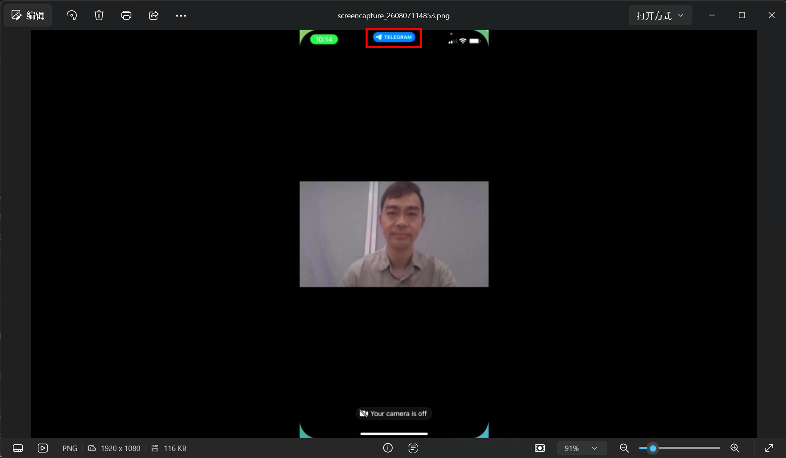

### 2、请根据参赛材料 VTM-1 回答以下问题:POON Chi-ming（VTM-1）在什么时间收到信用卡消费消息？（答案格式:请以 MMM-DD_hhmm 格式作答，例如:JAN-01_1523）

> AUG-07_0947

查看短信截图即可
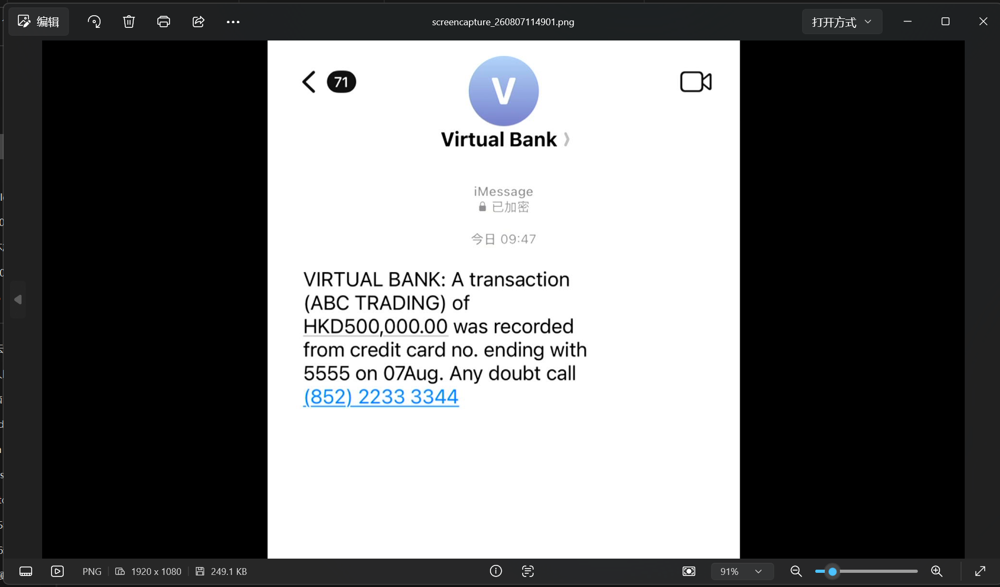

### 3、请根据参赛材料 VTM-1 回答以下问题:在 POON Chi-ming（VTM-1）的通话记录中，诈骗分子来电时显示的名称是什么？（答案格式:请按照原始数据作答，并区分英文大小写）

> KaHo

查看视频通话截图即可
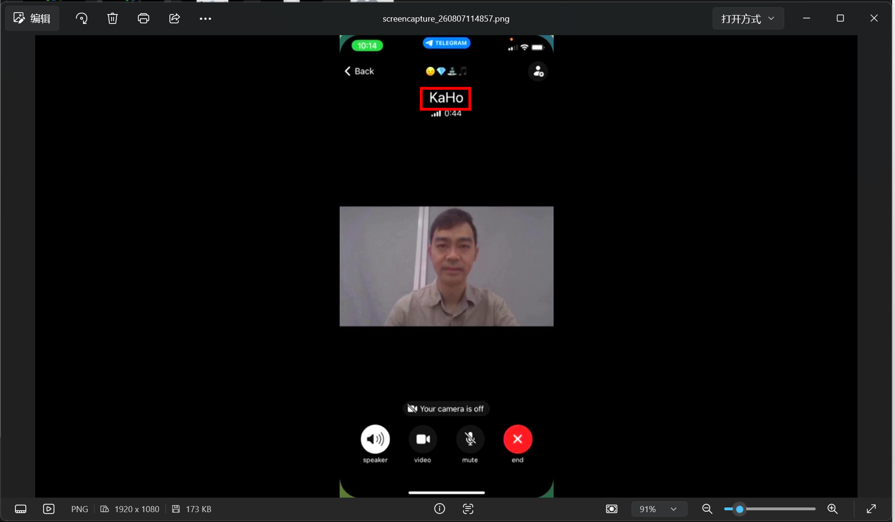

### 4、请根据参赛材料 VTM-2 回答以下问题:诈骗分子安排 SIU Wai-shing（VTM-2）在什么时间参加投资讲座？（答案格式:请以 hh:mm 格式填写 阿拉伯数字，例如:16:35）

> 14:00

打开 VTM-2 ，查看视频
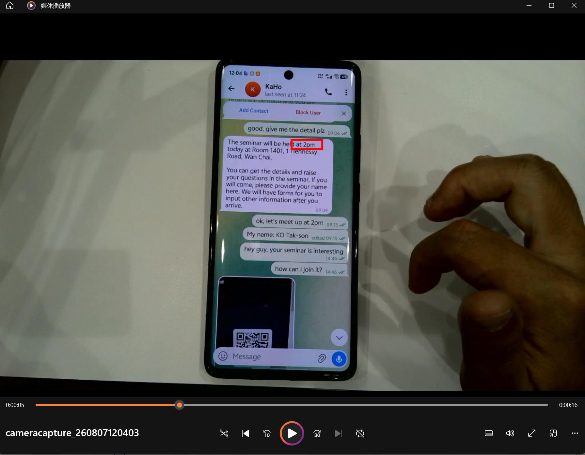

### 5、请根据参赛材料 FC-01 回答以下问题:冯程向张美透露，他此前曾在哪里工作？

> 学校

分析 FC-01 ，冯程手机的 WhatsApp 与张美（Cheung Mei）的聊天记录中发现，冯程告诉张美以前在一所学校担任 IT 专员
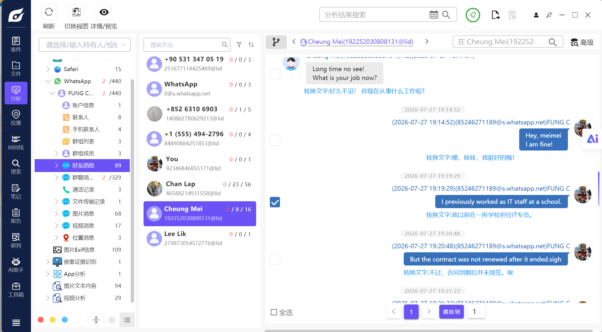

### 6、请根据参赛材料 FC-01 回答以下问题:请问群组「IT Working Group」的建立者，其在数据库底层所记录之帐户标识符（JID / Creator JID）为何？（答案格式:请按照原始数据库记录完整填写，包含后缀，例如:123456789012345@lid）

> 192252030808131@lid
 
查看 WhatsApp 群组列表，找到 IT Working Group 即可看到建立者
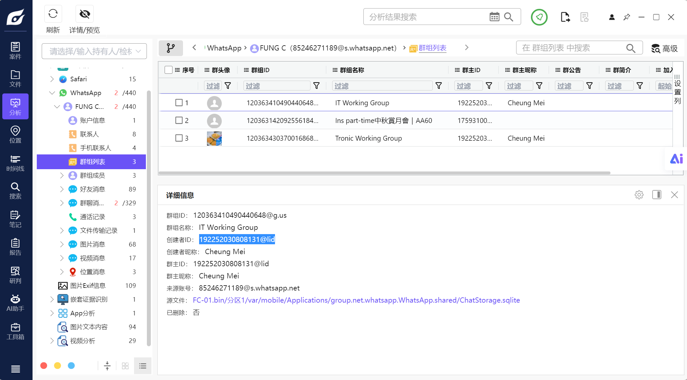

### 7、请根据参赛材料 FC-01 回答以下问题:在涉案群组「IT Working Group」对话记录中，冯程的手机所记录之发送与接收讯息总数（合计）共有多少条？（答案格式:仅填写阿拉伯数字，例如:88）

> 111

在火眼里看到的是 109 条
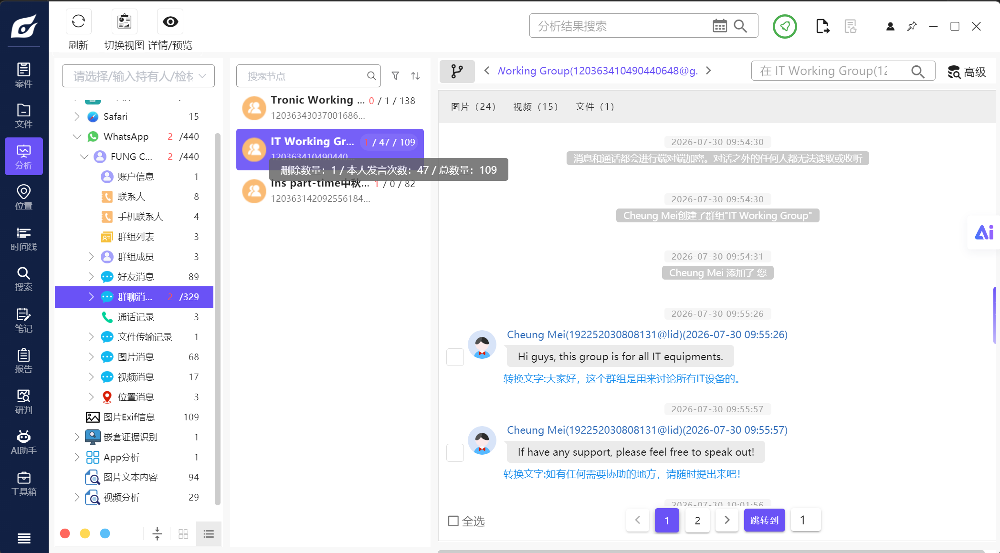
但在取证大师里看到是 111 条
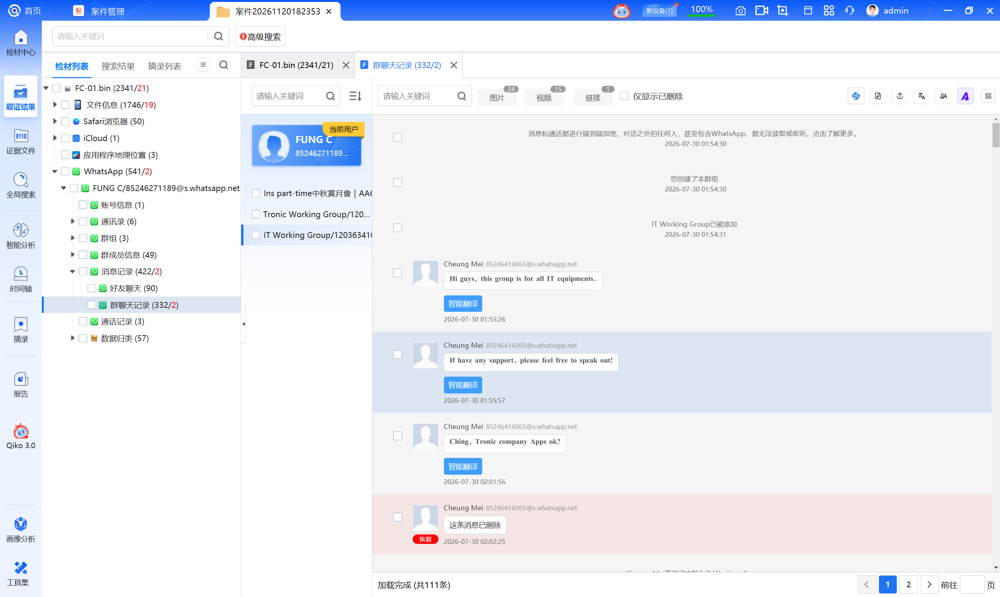
找到 WhatsApp 群组聊天数据库（FC-01.bin/分区1/var/mobile/Applications/group.net.whatsapp.WhatsApp.shared/ChatStorage.sqlite），查找 IT Working Group 对话记录，发现是 111 条
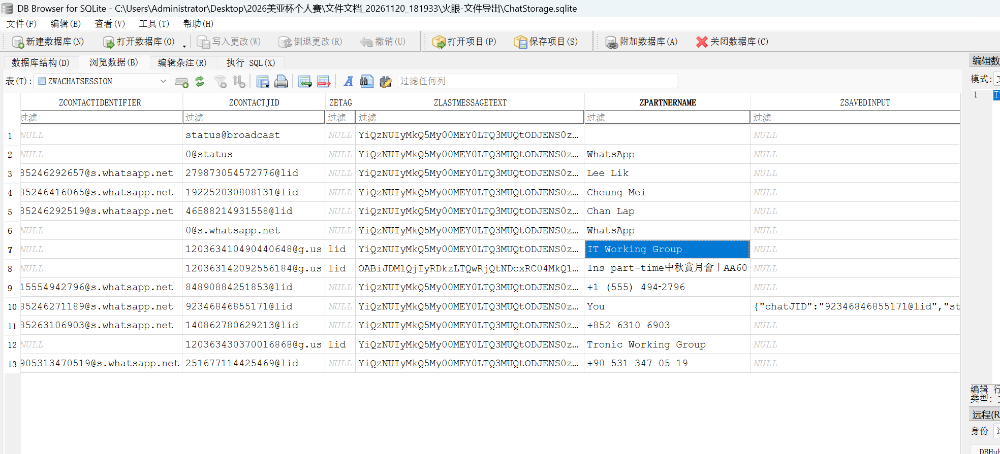
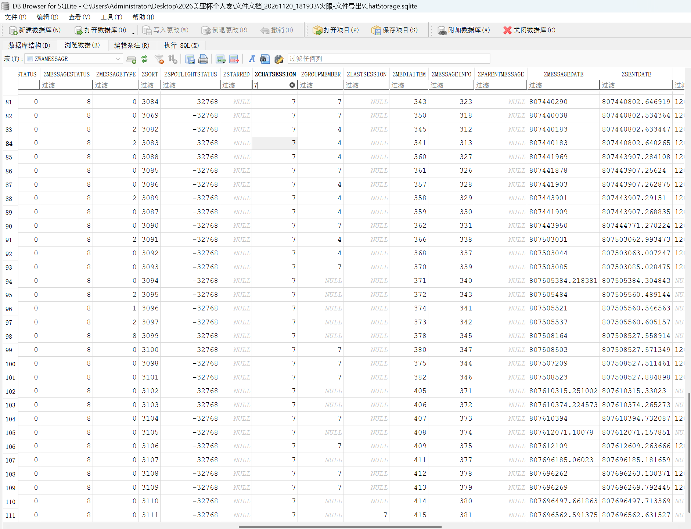
问了 AI ，回答大概是不同的取证软件对待群本身的管理元数据可能不同，像群创建、群名变更不构成用户间的对话内容，因此可能被取证软件从“对话记录”计数中剔除
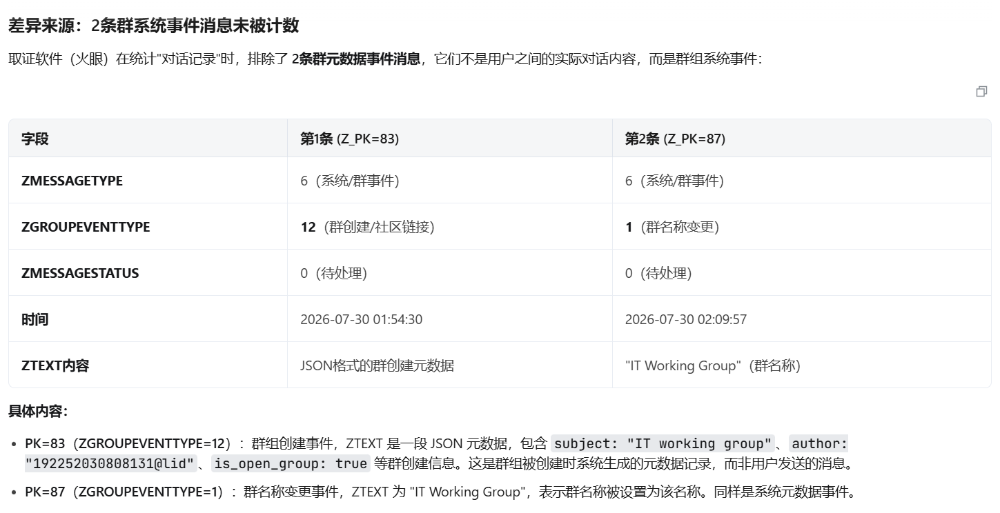
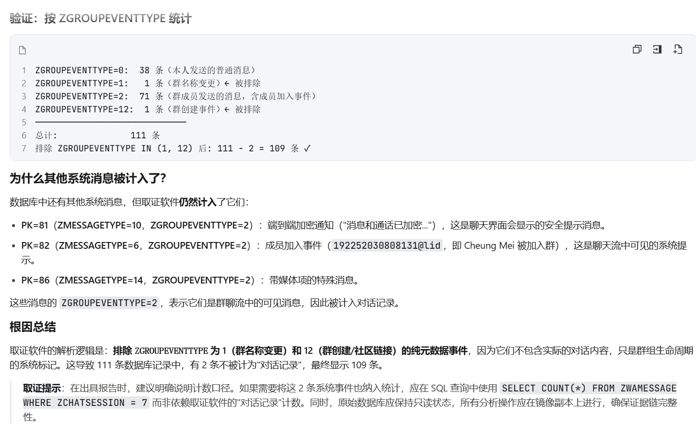

### 8、请根据参赛材料 FC-01 回答以下问题:涉案人员冯程（Fung Ching）其 WhatsApp 账号所设定之个人头像原始图片档案，在该备份架构的列表索引（Manifest）中，该头像档案所对应的备份文件标识符（fileID）为何？（答案格式:请按照原始记录完整作答，英文字母统一为全小写和数字）

> df40ecf80230f659346084bc556ce96b0646eb2f

查看头像信息，发现其为 Photo.jpg ，在 Manifest.db 中查找
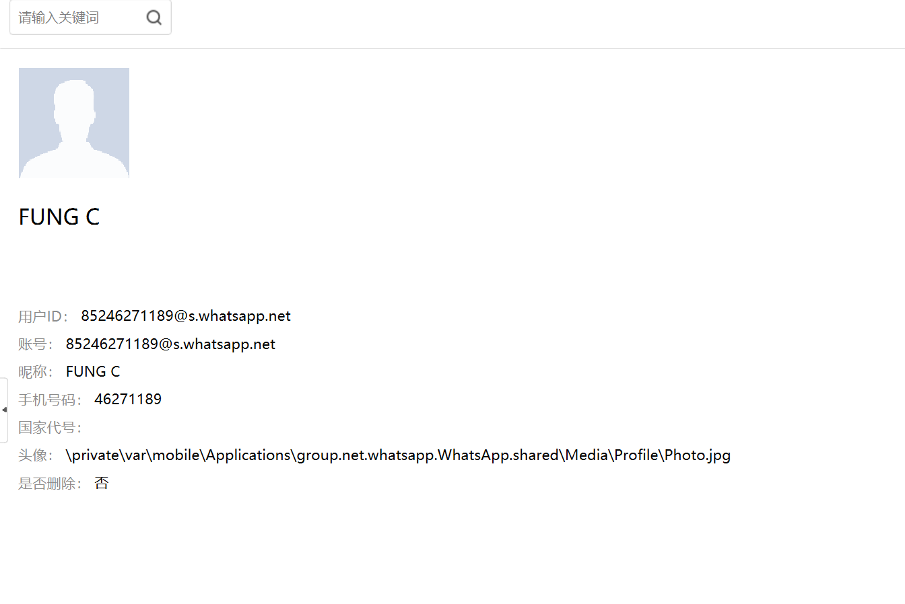
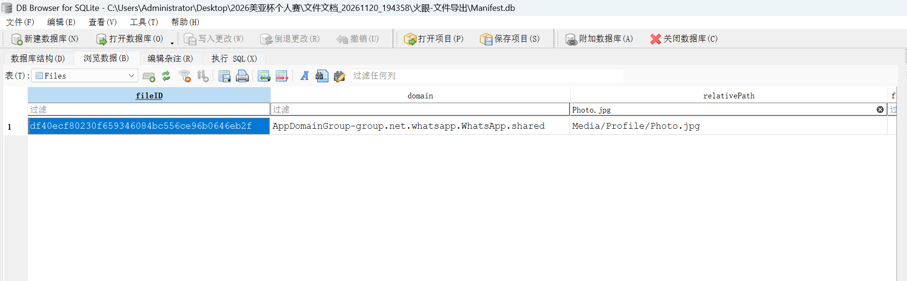

### 9、请根据参赛材料 FC-01 回答以下问题:调查人员在分析涉案人员冯程（Fung Ching）的手机时，发现涉案人员曾试图销毁关键照片。请问哪一张照片在拍摄或生成后不足 20 秒内即被迅速移至垃圾桶？（答案格式:请按照源文件名称完整作答，并保留英文大小写与扩展名，例如:IMG_0123.JPG）

> IMG_0015.JPG

未解出

### 10、请根据参赛材料 FC-01 回答以下问题:承接上题，在涉案群组的视讯通话记录中，唯一被涉案装置成功接通的视讯通话，其所属组名、通话开始时间（以UTC+8计算）及通话持续时间分别为何？

> Tronic Working Group, 2026-08-04 09:48:25, 135秒

查看 WhatsApp 通话记录，仅一次成功接通
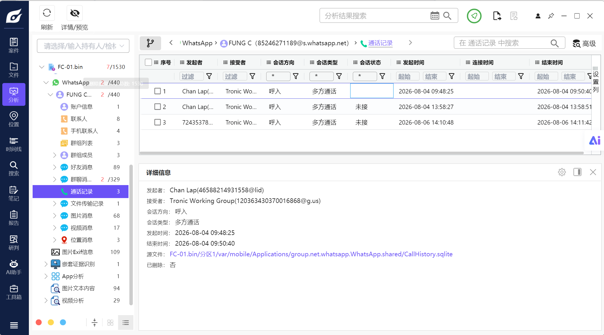

### 11、请根据参赛材料 FC-01 回答以下问题:根据底层系统进程导入记录（Imported By Bundle Identifier），该手机上主动进行屏幕截图（Screenshots）的图像共有多少张？（答案格式:仅填写阿拉伯数字）

> 7

未解出

### 12、请根据参赛材料 FC-01 回答以下问题:调查人员在分析涉案人员冯程（Fung Ching）装置内的 WhatsApp 群组记录时，发现有一条讯息提及两名客户分别投资 HK$80,000 和 HK$500,000。最早阅读该讯息的群组成员是谁？

> Lap Chan

查看群组聊天记录
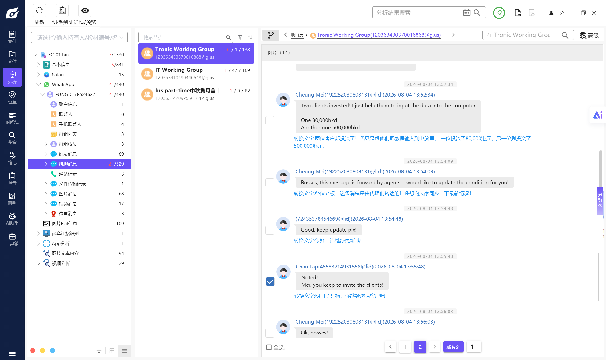

### 13、请根据参赛材料 FC-01 回答以下问题:根据冯程（Fung Ching）的手机设备，以下哪些电话号码由 CHAN Lap 使用？

> +85246292518  +85246292519

查看手机通讯录
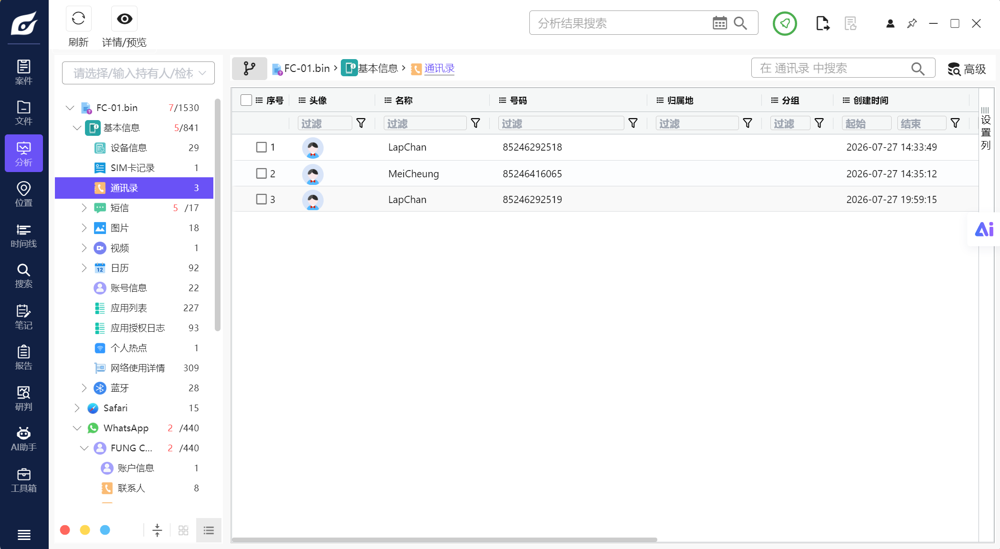

### 14、请根据参赛材料 FC-01 回答以下问题:在「CHAN Lap（陈立）」名下登记的电话号码中，哪一个电话号码在 WhatsApp 通讯应用程序中的实际使用？（答案格式:请按照数据库原始记录完整作答，保留「+」号及全部数字，不加空格，例如:+85212345678）

> +85246292519

查看 WhatsApp 手机联系人数据库（FC-01.bin/分区1/var/mobile/Applications/group.net.whatsapp.WhatsApp.shared/ContactsV2.sqlite），发现 +85246292519 的 ZLID 有值而 +85246292518 无
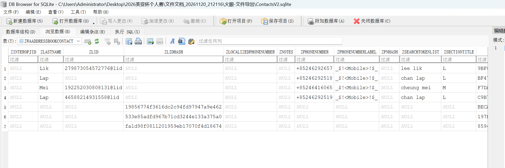

### 15、请根据镜像文件 FC-01 回答以下问题:该设备在相簿目录中所生成的第一张照片之完整文件名是什么？

> IMG_0001.PNG

找到相册目录，发现缺少 IMG_0001 ，直接查看 Photos.sqlite（FC-01.bin/分区1/var/mobile/Media/PhotoData/Photos.sqlite），发现 ZASSET 表主键 Z_PK=1 缺失，可能被删除。导入Photos.sqlite-wal（FC-01.bin/分区1/var/mobile/Media/PhotoData/Photos.sqlite-wal）和Photos.sqlite-shm（FC-01.bin/分区1/var/mobile/Media/PhotoData/Photos.sqlite-shm）检查删除变更，发现可疑记录
```SQL
SELECT
  t.ZTIMESTAMP                                   AS cd_ts,
  datetime(t.ZTIMESTAMP + 978307200,'unixepoch') AS utc_time,
  c.ZCHANGETYPE, c.ZENTITY, c.ZENTITYPK,
  c.ZTOMBSTONE0, c.ZTOMBSTONE1, c.ZTOMBSTONE2,
  c.ZTOMBSTONE3, c.ZTOMBSTONE4, c.ZTOMBSTONE5
FROM ACHANGE c
JOIN ATRANSACTION t ON c.ZTRANSACTIONID = t.Z_PK
WHERE c.ZTOMBSTONE0 IS NOT NULL
ORDER BY t.ZTIMESTAMP;
```
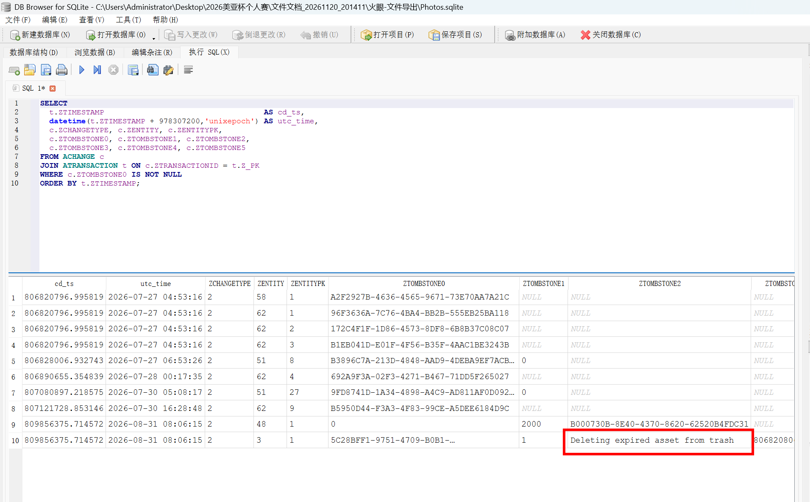
其 UUID 为 5C28BFF1-9751-4709-B0B1-B20C9ECF5D8F ，在 wal 中查找字符串，发现其为 IMG_0001.PNG
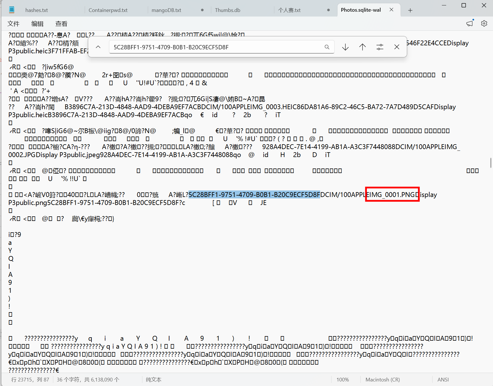

### 16、请根据镜像文件 FC-01 回答以下问题:承接上题，经排查该相片已被删除。该相片被删除的准确时间是什么（以 UTC+8 表示）？（答案格式:请按 YYYY-MM-DD HH:mm:ss 格式作答，例如:2026-01-01 12:00:00）

> 2026-07-27 12:53:26

接 15 题，列出该文件，可知被删除时间为 2026-07-27 12:53:26
```SQL
SELECT
  c.ZENTITYPK                        AS asset_pk,
  c.ZTOMBSTONE5                      AS asset_uuid,
  c.ZTOMBSTONE2                      AS delete_reason,
  datetime(c.ZTOMBSTONE3 + 978307200,'unixepoch')  AS trashed_utc,
  datetime(c.ZTOMBSTONE3 + 978307200 + 28800,'unixepoch') AS trashed_hkt,
  datetime(t.ZTIMESTAMP  + 978307200,'unixepoch')  AS purged_utc,
  t.ZAUTHOR
FROM ACHANGE c
JOIN ATRANSACTION t ON c.ZTRANSACTIONID = t.Z_PK
WHERE c.ZENTITY = 3 AND c.ZTOMBSTONE2 LIKE '%trash%';
```
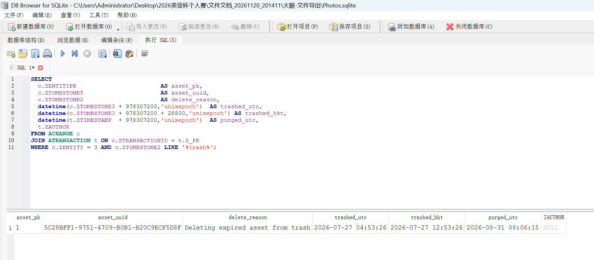

### 17、请根据镜像文件 FC-01 回答以下问题:承接上题，请指出该相片的全局唯一标识符（ZUUID）是什么？（答案格式:请按标准 UUID 格式填写，英文字母大写并包含连字符，例如:12345678-ABCD-EF01-2345-6789ABCDEF01）

> 5C28BFF1-9751-4709-B0B1-B20C9ECF5D8F

见 15 题

### 18、请根据镜像文件 FC-01 回答以下问题:承接上题，请指出该相片的原始文件大小是多少字节（Byte）？（答案格式:仅填写半角阿拉伯数字，例如:102400）

> 318970

将 wal 导入 FQLite ，在 ZADDITIONALASSETATTRIBUTES 表中找到 IMG_0001.PNG ，其 ZORIGINALFILESIZE 字段为 318970

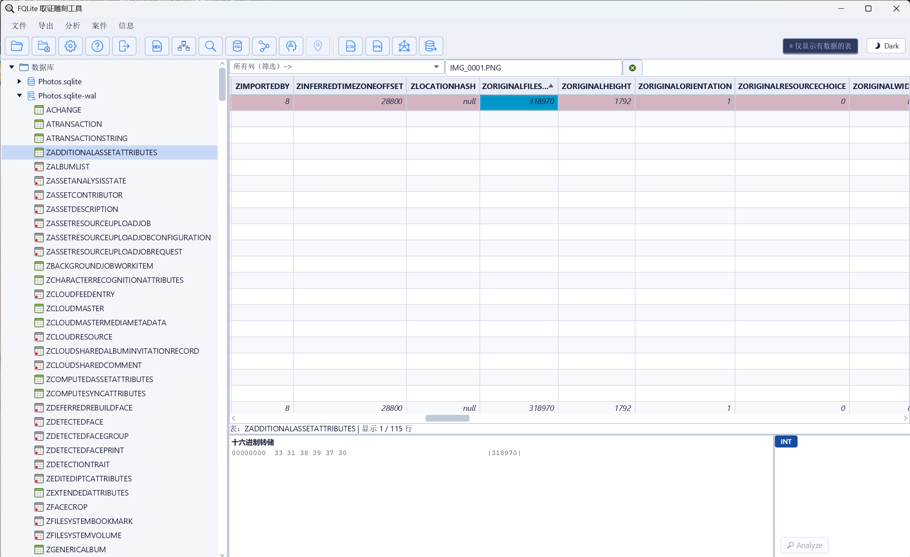

### 19、请根据镜像文件 FC-01 回答以下问题:承接上题，该已删除相片曾同步至 iCloud 的主资源记录，请指出其在数据表中所记录的云端主唯一标识符（ZCLOUDMASTERGUID）是什么？（答案格式:请严格区分英文字母大小写并完整填写字符串，包含加号“+”等特殊符号，不含空格，例如:Bq1adfkjadDSDFjkahdf+ljaljsfEdfa）

> Aa1sazGmizbawcNL+g4HklK5aEqo

接 18 题，ZORIGINALSTABLEHASH 字段为 Aa1sazGmizbawcNL+g4HklK5aEqo
- tips：ZORIGINALSTABLEHASH 是 Apple 照片库给每个资产（照片/视频）分配的”稳定标识符“，用来在整个生态里唯一定位这张照片。名字里的"Stable"是关键：它跨设备、跨同步、跨编辑都不变。
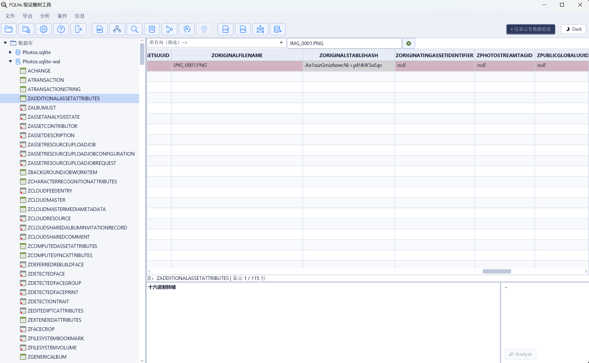

### 20、请根据镜像文件 COM-01 回答以下问题:根据镜像文件中保存的系统配置记录，该主机 Windows 操作系统的内部版本号（Build Number）是什么？（答案格式:仅填写阿拉伯数字）

> 26200

挂载 COM-01.bin ，查看系统信息
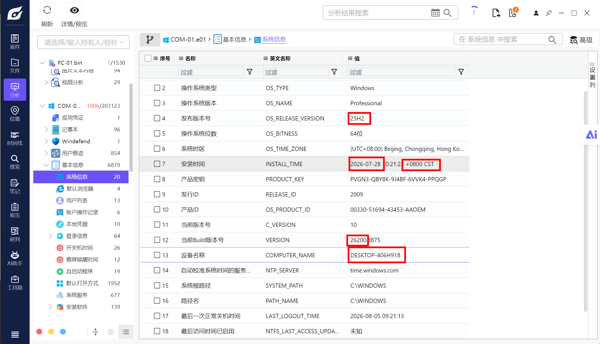

### 21、请根据镜像文件 COM-01 回答以下问题:根据该操作系统初始安装时间戳（以 UTC 时间为准），其安装日期是什么？（答案格式:请以 YYYY-MM-DD 格式作答，例如:2024-01-01）

> 2026-07-28

同 20 题

### 22、请根据镜像文件 COM-01 回答以下问题:根据系统配置信息，该主机所安装 Windows 操作系统的显示版本（Display Version）是什么？

> 25H2

同 20 题

### 23、请根据镜像文件 COM-01 回答以下问题:根据系统保存的核心配置记录，该主机的计算机名称（Computer Name／Hostname）是什么？（答案格式:请按照原文填写大写英文字母、数字和符号）

> DESKTOP-406H918

同 20 题

### 24、请根据镜像文件 COM-01 回答以下问题:根据系统保存的核心时区配置，该主机操作系统配置的标准时区是什么？

> UTC+0800

同 20 题

### 25、请根据镜像文件 COM-01 回答以下问题:调查人员比对了系统中保存的安全标识符（SID）、用户账号及用户配置文件记录。以下关于该主机的说法，哪些正确？

> i. 除系统内置服务账号外，人工创建的主要涉案用户账号 Tronic_Office，其安全标识符末尾的相对标识符（RID）为1001

> ii. 系统中记录的自建账号 Tronic_Guest，其实际用户配置文件路径对应的 SID 末尾 RID 为 1004

> iii. 用户配置文件列表中最后创建的本地用户账号为 Wah，其 RID 为 1006

查看用户列表，可知 i、ii、iii 正确，根据最后登录时间可知，主机最近一次登录系统的本地用户账号为 Tronic_Guest
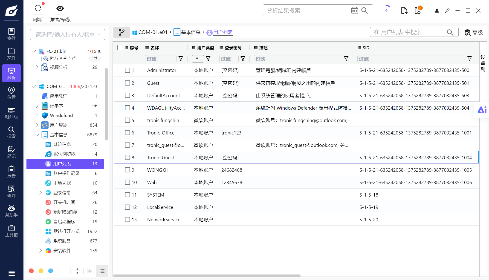
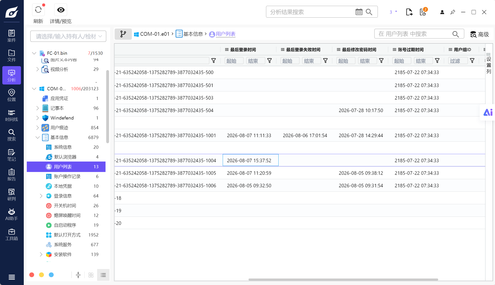

### 26、请根据镜像文件 COM-01 回答以下问题:调查人员在本地安全账号数据库中发现一个相对标识符为 000003EC（十六进制）的本地用户账号。该标识符对应的用户名是什么？（答案格式:请按照原文填写用户名，并区分英文大小写）

> Tronic_Guest

算一下是 1004 ，由 25 题可知为 Tronic_Guest
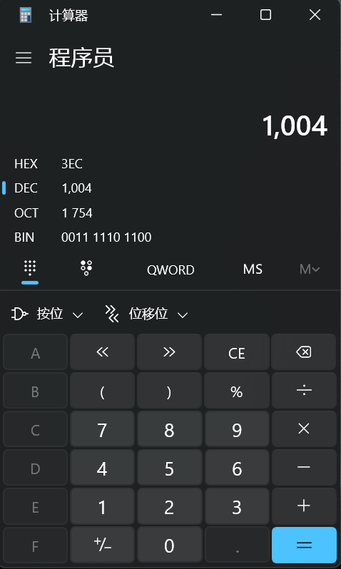

### 27、请根据镜像文件 COM-01 回答以下问题:本地用户 Wah 最近一次修改密码的时间是什么？（答案格式:请换算为时间 UTC+08:00，并以 YYYY-MM-DD hh:mm:ss 格式填写 阿拉伯数字，例如:2026-01-01 14:30:00）

> 2026-08-05 09:31:54

查看用户列表可知 Wah 最近一次修改密码的时间
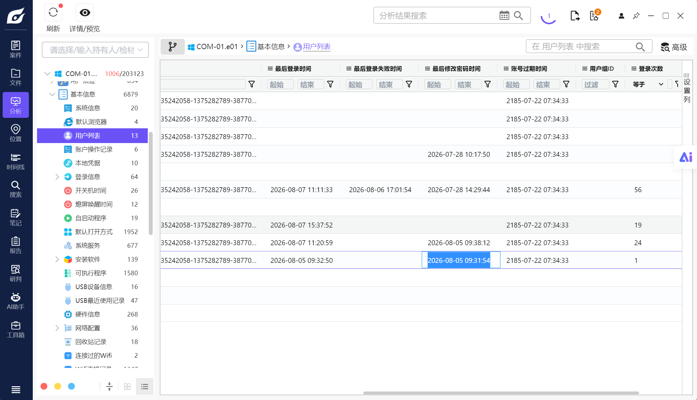

### 28、请根据镜像文件 COM-01 回答以下问题:用户账号 WONGKH 设置的“密码提示”内容是什么？（答案格式:请填写解码后的明文字符串）

> 28

查看用户列表， WONGKH 的 RID 为 1005，即 000003ED 。导出用户账户注册表（COM-01.e01/分区1/Windows/System32/config/SAM	），查看 SAM/Domains/Account/Users/000003ED ，存在 UserPasswordHint ，明文为 28
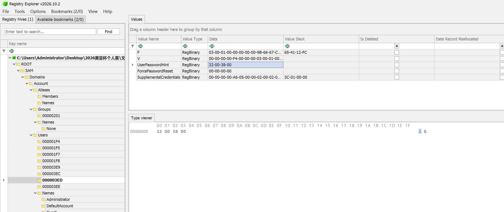

### 29、请根据镜像文件 COM-01 回答以下问题:调查显示，该主机的事件日志曾被人为或异常清除。根据系统事件日志记录，应用程序（Application）事件日志共被清除过多少次？

> 2

查看 Windows 事件日志，筛选事件 ID 104 ，数据包含 Application ，共 2 条记录
- tips：事件 ID 104 为通用的”日志文件已清除“事件，适用于 Application、System、Setup 等所有常规日志
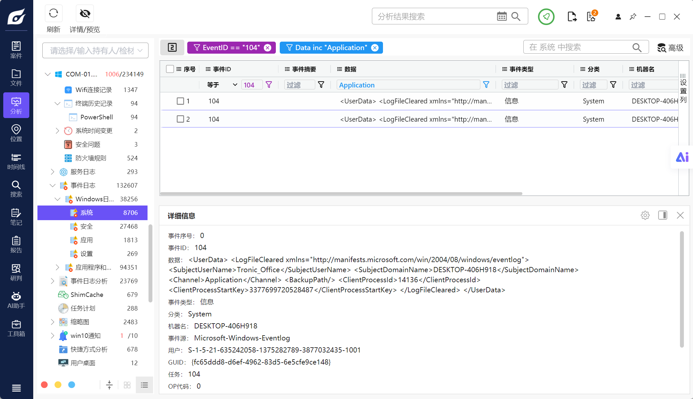

### 30、请根据镜像文件 COM-01 回答以下问题:根据系统事件记录，在 2026-08-03 23:07:00（UTC+08:00）执行日志清除操作的本地用户账号是什么？（答案格式:请按照原文填写用户名，并区分英文大小写）

> Tronic_Office

由 29 题可知，该用户 RID 为 1001 ，查看用户列表得知为 Tronic_Office

### 31、请根据镜像文件 COM-01 回答以下问题:该主机安全日志（Security Log）中现存的最早事件仅能追溯至 2026-08-05，更早的历史活动记录均未保留。根据系统服务配置和事件记录机制，造成该日志从该日期开始记录的主要原因是什么？

> 系统配置之记录文件容量上限维持默认 20MB，旧事件因容量额满而遭自动循环覆写

事件 ID 1105 ”事件日志自动备份“，表示日志自动归档；事件 ID 104 / 1102 日志被手动清除。筛选后发现均无相关事件，查看安全日志（C:\Windows\System32\Winevt\Logs\Security.evtx）大小为 20MB ，可以确定是文件容量达到上限自动覆写

### 32、请根据镜像文件 COM-01 回答以下问题:本地用户账号 Tronic_Office 的 NTLM 密码哈希值（NTLM Hash）是什么？（答案格式:请填写由 32 个小写十六进制字符组成的字符串）

> 53247fcc36864953f674f14b32b3cb82

查看用户列表即可
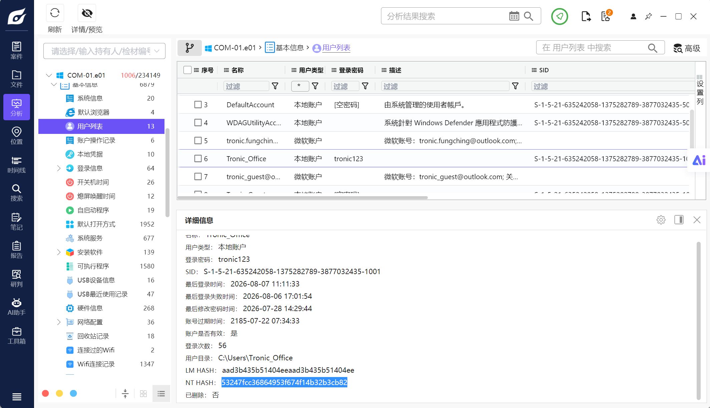

### 33、请根据镜像文件 COM-01 回答以下问题:调查发现，该主机RID 为 1006的本地用户账号使用了常见弱密码。该用户名及其明文密码分别是什么？（答案格式:请按“账号名称:密码”格式作答，例如:Admin:Pass123）

> Wah:12345678

解法同 32 题

### 34、请根据镜像文件 COM-01 回答以下问题:根据本地用户 Tronic_Office 的回收站（Recycle Bin）记录，该用户最后一次移入回收站的原始文件名是什么？（答案格式:请填写包含扩展名的完整原始文件名，保留英文大小写、原有空格、括号及其他标点须按原文保留，例如:sample file.jpg）

> 75344 - Copy.jpg

查看回收站记录，最后一次移入回收站且为 Tronic_Office （RID 为 1001）操作的原始文件名是 75344 - Copy.jpg
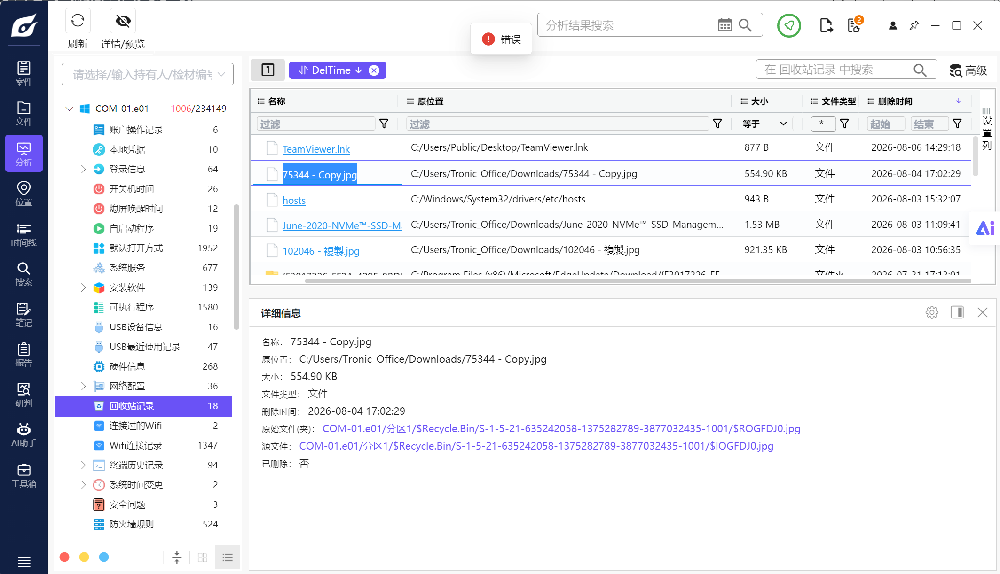

### 35、请根据镜像文件 COM-01 回答以下问题:承接上题，该文件被移入回收站前所在的原始目录路径是什么？

> C:\Users\Tronic_Office\Downloads\

同 34 题

### 36、请根据镜像文件 COM-01 回答以下问题:该主机最后一次被访问的多媒体文件（图像或视频）的原始完整路径是什么？

> C:\Users\Tronic_Office\Pictures\Screenshots\image2.jpg

查看用户痕迹>最近访问的项目，按时间排序，查找多媒体文件
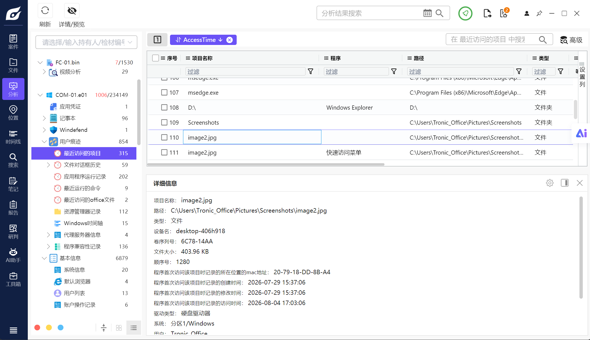

### 37、请根据镜像文件 COM-01 回答以下问题:本地用户 Tronic_Office 最近一次打开 PDF 文件的时间戳是什么？（答案格式:请换算为时间 UTC+08:00，并以 YYYY-MM-DD hh:mm:ss 格式填写 阿拉伯数字，例如:2026-01-01 15:30:00）

> 2026-08-04 17:01:26（正确答案为2026-08-04 17:01:27）

查看最近访问的项目，筛选 PDF ，发现时间为 2026-08-04 17:01:26
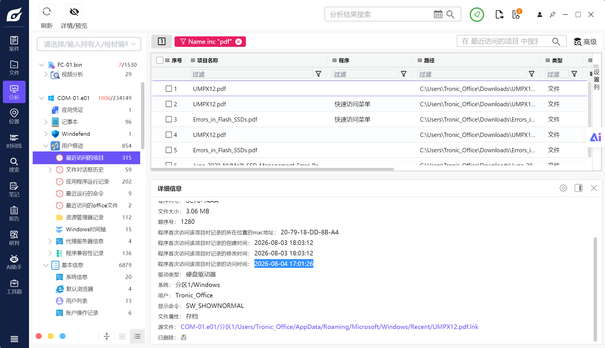

### 38、请根据镜像文件 COM-01 回答以下问题:涉案人员曾在系统注册表中手动设置无线网卡（Intel Dual Band Wireless-AC 8265）的伪造 MAC 地址。该设置值是什么？（答案格式:请填写大写英文字母和数字，不含前缀 0x、冒号、连字符或空格，例如:A1B2C3D4E5F6）

> 20791ADD88A0

导出网卡相关注册表SYSTEM（COM-01.e01/分区1/Windows/System32/config/SYSTEM）及 SYSTEM.LOG1 、 SYSTEM.LOG2 ，查看 ROOT/ControlSet001/Control/Class/{4d36e972-e325-11ce-bfc1-08002be10318}/0000 中记录的 NetworkAddress 即 MAC 地址为 20791ADD88A0
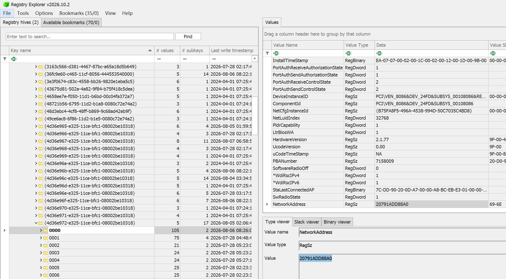

### 39、请根据镜像文件 COM-01 回答以下问题:该无线网卡（Wi-Fi NIC）实际使用的物理 MAC 地址是什么？（答案格式:请填写大写英文字母和数字，不含前缀 0x、冒号、连字符或空格，例如:A1B2C3D4E5F6）

> 207918DD8BA0

查看网络配置即可
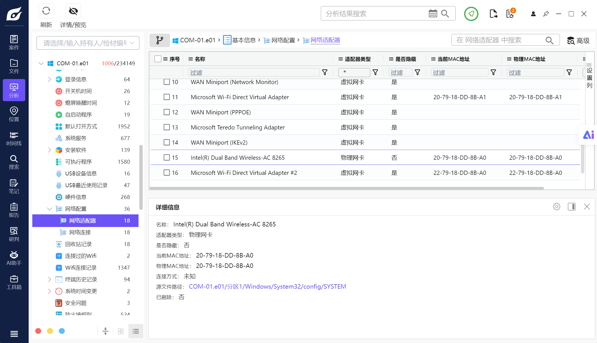

### 40、请 COM-01 COM-01 回答以下问题:根据系统保存的无线网络连接配置文件元数据，该主机最后一次连接的 Wi-Fi 网络所对应的配置文件标识符（Profile GUID）是什么？（答案格式:须包含首尾大括号“{}”和中间的连字符“-”；请填写大写英文字母和数字，例如:{XXXXXXXX-XXXX-XXXX-XXXX-XXXXXXXXXXXX}）

> {07551AB8-72BC-4CFF-AE9E-89413D862D74}

查看 Wifi 连接记录，最后一次连接的网络 SSID 为 tronic 
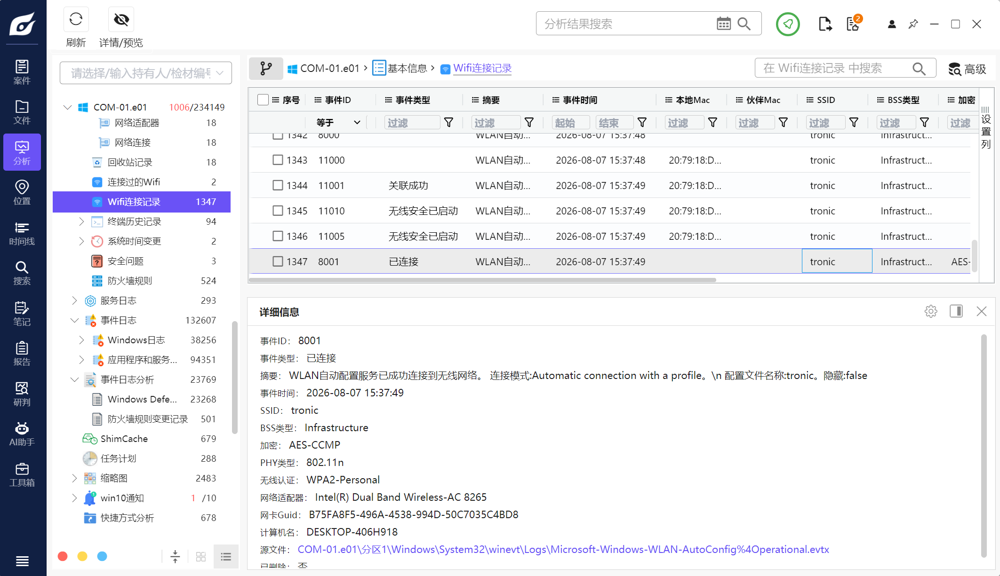
导出无线网络相关注册表 SOFTWARE（COM-01.e01/分区1/Windows/System32/config/SOFTWARE）及 SOFTWARE.LOG1 、 SOFTWARE.LOG2 ，查看 ROOT/Microsoft/Windows NT/CurrentVersion/NetworkList/Profiles 中的文件，发现 tronic 对应文件为 {07551AB8-72BC-4CFF-AE9E-89413D862D74}
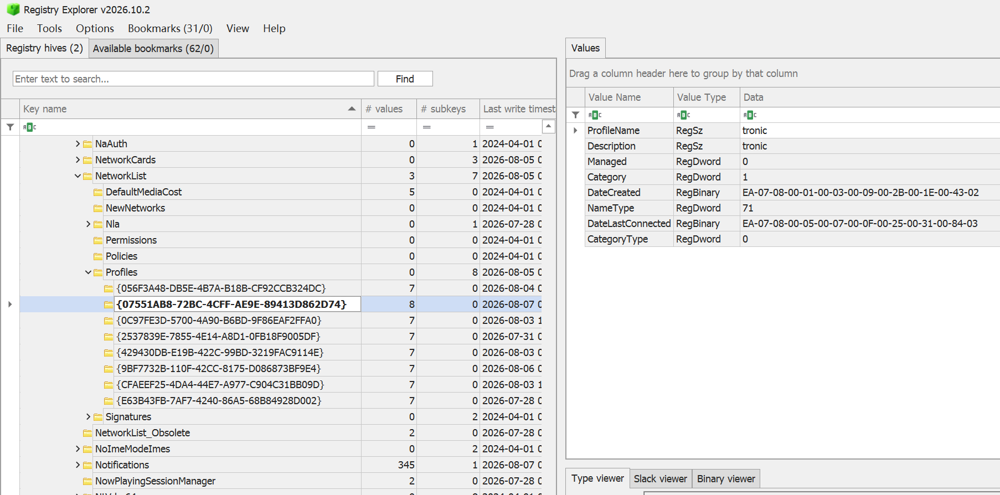

### 41、请根据镜像文件 COM-01 回答以下问题:本地用户 Tronic_Office 桌面上的时间戳修改工具最后一次执行的时间戳是什么？（答案格式:请换算为时间 UTC+08:00，并以 YYYY-MM-DD hh:mm:ss 格式填写 阿拉伯数字，例如:2026-01-01 15:30:00）

> 2026-08-07 11:11:39

查看用户痕迹>应用程序运行记录，筛选"time"，发现 TimeStamp Changer.exe 使用情况
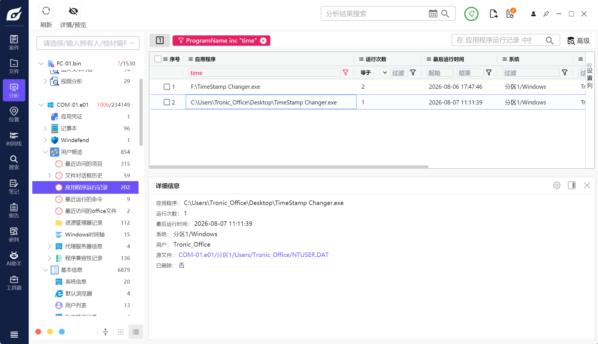

### 42、请根据镜像文件 COM-01 回答以下问题:涉案人员曾运行时间戳篡改工具，故意修改下载目录中视频文件 videoplayback (1).mp4 的文件系统属性时间。通过分析 NTFS 文件系统底层元数据，该文件未被篡改的原始创建时间（本地时间 UTC+08:00）是什么？

> 2026-08-04 09:51:53

查看用户痕迹>最近访问的项目，筛选 mp4 ，找到 videoplayback (1).mp4 创建时间
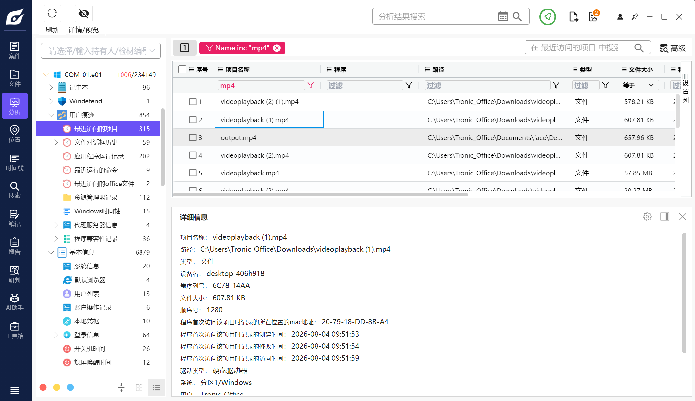

### 43、请根据镜像文件 COM-01 回答以下问题:本地用户 Tronic_Office 曾人为更改其用户文件夹中一个图像文件的扩展名。该图像文件的真实扩展名是什么？

> png

查看该用户照片文件夹（COM-01.e01/分区1/Users/Tronic_Office/Pictures/Screenshots）中的照片，发现 image2.jpg 的真实文件头为 png
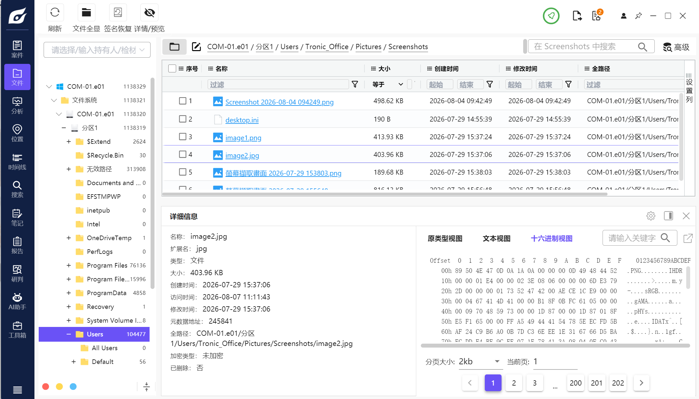

### 44、请根据镜像文件 COM-01 回答以下问题:根据系统安全防护日志，该主机曾检测到一个被分类为木马（Trojan）的恶意程序试图运行。该恶意程序的文件名是什么？（答案格式:请填写包含扩展名的程序文件名，无需填写路径；请用全英文小写，例如:malware.exe）

> svchost.exe

查看 Windefend 历史记录
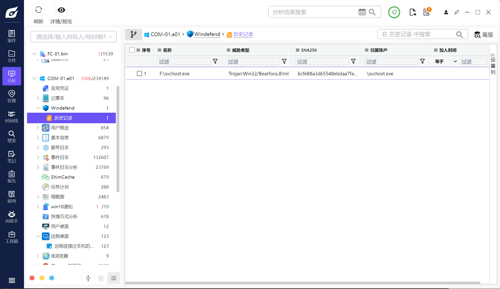

### 45、请根据镜像文件 COM-01 回答以下问题:承接上题，该木马程序被系统防护机制检测并拦截的时间（UTC+08:00）是什么？

