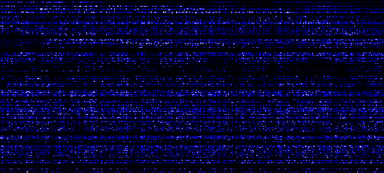
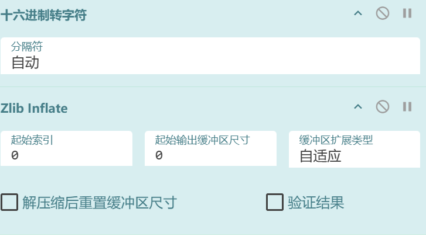
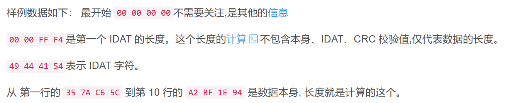
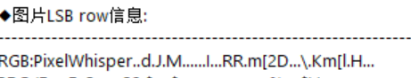
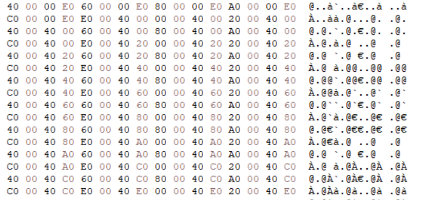
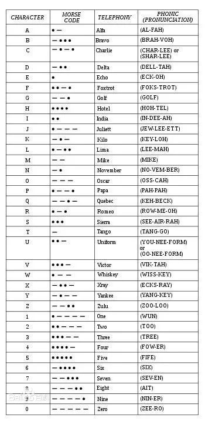
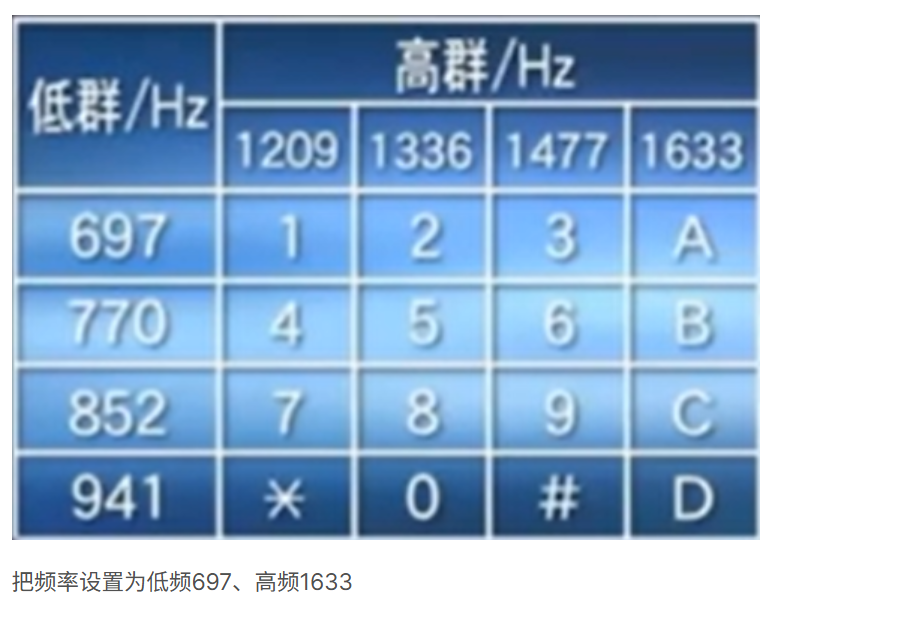
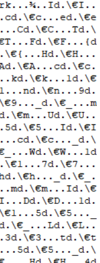

## 写在前面

作为CTF中题型边界最宽泛、自由度最高的门类，misc涉及的范围极广，文章记录了作者的misc学习笔记。

## 1. 信息搜集技术

### 1.1 网络信息搜集技巧

- 公开渠道
- 目标 Web 网页、地理位置、相关组织
- 组织结构和人员、个人资料、电话、电子邮件
- 网络配置、安全防护机制的策略和技术细节
- 通过搜索引擎查找特定安全漏洞或私密信息的方法
- Google Hacking Database
- 科学上网

### 1.2 基本搜索技巧
- Google 基本搜索与挖掘技巧
- 保持简单明了的关键词
- 使用最可能出现在要查找的网页上的字词
- 尽量简明扼要地描述要查找的内容
- 选择独特性的描述字词
- 社会公共信息库查询
- 个人信息：人口统计局
- 企业等实体：YellowPage、企业信用信息网
- 网站、域名、IP：whois 等

### 1.3 地图和街景搜索
- 国外：Google Map、Google Earth、Google Street View
- 国内：百度地图、卫星地图、街景
- 从网络世界到物理世界：IP2Location
- whois 数据库
- GeoIP
- IP2Location
- 纯真数据库（QQ IP 查询）

## 2. 隐写综合

### 2.1 图片隐写

#### 2.1.1 总览

文件附加、exif信息包含（jpg）、图像宽高隐写、文件头尾修改、盲水印、F5隐写、rgb通道隐写、slienteye隐写、stegsolve文件信息、steghide隐写（key）、gif分帧、gif时间间隔、图片边缘隐藏（边缘像素块rgb通道）十六进制高位/低位提取、字节反转、立体图

#### 2.1.2 zsteg 使用

基本用法: zsteg [选项] 示例.png [参数]

|选项|描述|
|--|--|
|a, --all|尝试所有已知方法|
|E, --extract NAME|提取指定的有效载荷，NAME 格式如 '1b,rgb,lsb'| 

|迭代/提取参数|描述|备注|
|--|--|--|
|o, --order X|像素迭代顺序（默认值：'auto'）|有效值: ALL,xy,yx,XY,YX,xy',yX,bY, |
|c, --channels X|通道（R/G/B/A），逗号分隔|有效值: r,g,b,a,rg,bgr,rgba,r3g2b3, |
|b, --bits N|位数，单个整数值或 '1,3,5' 或范围 '1-8'|高级：指定单个位如 '00001110' 或 '0x88'|
|lsb|最低有效位优先|
|msb|最高有效位优先|
|P, --prime|只分析/提取素数字节/像素|
|shift N|预填充 N 个零位|
|invert|反转位（XOR 0xff）|
|pixel-align|像素对齐隐藏数据|

|分析参数|描述|
|--|--|
|l, --limit N|限制检查的字节数，0 = 无限制（默认值：256）|

#### 2.1.3 普通盲水印
python bwmforpy3.py decode 加水印.png 原图.png 盲水印.png --oldseed
python bwm.py decode 加水印.png 原图.png 盲水印.png

hint：原图与加水印图片xor异或后会出现条纹


#### 2.1.4 频域盲水印
python encode.py --image <原图> --watermark <水印> --result <加水印>
python decode.py --original 加水印.png --image 原图.png --result 水印.png

#### 2.1.5.F5隐写
解密操作：Kali中的F5文件夹里执行
java --add-exports java.base/sun.security.provider=ALL-UNNAMED Extract /home/kali/桌面/F5-steganography/示例.jpg -p 密钥，解密结果保存到output.txt中

#### 2.1.6.IDAT隐写

隐写原理：PNG的数据压缩后存储到IDAT块，并且只有存满才能存到下一个IDAT块，在IDAT隐写中，一个IDAT数据块没有存满，但是出现了新的IDAT块，对异常IDAT块进行Zlib解压缩，之后再对数据进行其他的处理。





最后4字节为crc，去掉。

py脚本：
```python
import zlib
import binascii
IDAT = "66 6c 61 67 ".decode('hex') # 双引号中填IDAT数据
result = binascii.hexlify(zlib.decompress(IDAT))
print(result)
```

#### 2.1.7 十六进制高位/低位隐藏信息（hao/高位低位）

#### 2.1.8 其他hint

这种即存在有效信息

形如大概率为bmp图片


### 2.2 音频隐写
#### 2.2.1 总览
MP3stego（key）、波形频谱图morse密码、拨号音解密、slienteye隐写、音频倒放、国际无线电通话拼写字母（字母解释法）、grc文件fm解调，sstv图像转音频（ SSTV 解码）https://sstv-decoder.mathieurenaud.fr/

#### 2.2.2  MP3stego
.\Decode.exe -X -P <密钥> 示例.mp3

#### 2.2.3 字母解释法
国际无线电通话拼写字母（字母解释法）


#### 2.2.4 拨号音解密
.\dtmf2num <路径>（wav格式）
随波逐流解密


#### 2.2.5  grc文件fm解调
C:\Users\Administrator\Desktop\hao\解调\demodulate.py

#### 2.2.6 其他hint
字符隐藏在相对重复十六进制片段中（如midi文件出现）


### 2.3 文档隐写
#### 2.3.1 总览
docx转zip、word隐藏文本

#### 2.3.2 加密 Word 爆破与宏破解
office2john 示例.docm > word.hash  （rar2john 1.rar>rar.hash）                                                                                                      
john --mask='?a' word.hash
john --show word.hash
在分析一些宏病毒时，按下Alt+F11尝试查看宏代码，但是往往会遇到密码保护。
可以将文件在任意一款十六进制编辑工具中打开该文件，比如010 editor，搜索DPB字符串，改成DPX，注意不要减少或者增加其他字符，保存退出。
重新打开文件，Alt + F11打开，右键打开属性，设置一个密码保存，重新打开文件Alt + F11输入密码即可查看宏代码。

## 3. 压缩包分析

### 3.1 总览
zip伪加密、弱密码字典攻击、掩码攻击、暴力破解、多文件crc32爆破、明文攻击、hashcat爆破、文件附加、异常时间戳

### 3.2 lzip解压：lzip -d 1.lzip

### 3.3 bkcrack明文攻击

- 密文ZIP (-C): 包含加密文件的ZIP档案
- 明文内容 (-p): 已知的明文文件或内容
- 目标文件 (-c): 要攻击的加密文件名

#### 3.3.1 基本用法
- 明文攻击基础命令
/usr/local/bkcrack -C Desktop.zip -c readme.txt -p readme.txt

参数说明: - -C encrypted.zip: 加密的ZIP文件 - -c target_file.txt: ZIP中要攻击的目标文件 - -p plaintext_file.txt: 本地的已知明文文件

- 使用ZIP中的明文
bkcrack -C encrypted.zip -c secret.txt -P plaintext.zip -p known.txt

参数说明: - -P plaintext.zip: 包含明文的ZIP文件 - -p known.txt: ZIP中对应的明文文件

- 指定偏移量
bkcrack -C encrypted.zip -c target.txt -p plain.txt -o 10

参数说明: - -o 10: 明文相对于密文的偏移量(字节)

#### 3.3.2 高级用法
使用十六进制数据
bkcrack -C encrypted.zip -c target.txt -x 0 504b0304
参数说明: - -x 0 504b0304: 在偏移0处指定十六进制明文数据

截断明文
/usr/local/bkcrack -C flag.zip -c flag.txt -p flag.txt -t 12
参数说明: - -t 100: 只使用前100字节的明文

密钥恢复后的操作
创建新的可解密ZIP
/usr/local/bkcrack -C Desktop.zip -k df96dc88 b432ddfd df4b9e93 -U decrypted.zip newpassword
参数说明: - -k: 三个恢复的内部密钥 - -U decrypted.zip: 输出的新ZIP文件 - newpassword: 为新ZIP设置的密码

直接解密文件
/usr/local/bkcrack -C flag.zip -k 68cc45ab 864060ce ac958caa -c flag.txt -d output.txt
参数说明: - -d output.txt: 直接解密输出到文件

恢复原始密码
bkcrack -k 12345678 87654321 abcdefab -r 8 ?a
参数说明: - -r 8: 密码长度 - ?a: 字符集(a=所有ASCII可打印字符)

命令参考
参数	长参数	描述
-C	--cipher-zip	加密的ZIP文件
-c	--cipher-file	目标加密文件
-P	--plain-zip	明文ZIP文件
-p	--plain-file	明文文件
-k	--keys	内部密钥
-U	--unlock	创建解锁的ZIP
-d	--decipher	解密文件
-o	--offset	偏移量
-x	--extra	十六进制明文
-t	--truncate	截断大小
-r	--recover-password	恢复原始密码
字符集选项 (用于密码恢复)
?l: 小写字母 (a-z)
?u: 大写字母 (A-Z)
?d: 数字 (0-9)
?s: 特殊字符
?a: 所有ASCII可打印字符


2.1.7  bkcrack明文攻击png
echo 89504E470D0A1A0A0000000D49484452 | xxd -r -ps > png_header
/usr/local/bkcrack -C 1.zip -c xor.png -p png_header -o 0 > 1.log&
/usr/local/bkcrack -C 1.zip -c xor.png -k 68cc45ab 864060ce ac958caa -d lbj.png


3.Hashcat
.\hashcat [选项]... <哈希文件> [字典/掩码/目录]...

核心选项：
-m <num>：哈希类型（0=MD5，1000=NTLM）。
-a <num>：攻击模式（0=字典）。
-o <file>：输出破解结果。
--show：显示已破解哈希。
-V：版本；-h：帮助。
完整帮助：hashcat -h | grep <关键词>。

0=MD5	100=SHA1	1000=NTLM	3200=bcrypt	17220=ZIP	22000=WPA2	13000=rar
查询：hashcat -h | grep ZIP。

4.1 直攻/字典攻击 (-a 0)
命令：hashcat -m 0 -a 0 hashes.txt rockyou.txt
带规则：hashcat -m 0 -a 0 hashes.txt rockyou.txt -r rules/best64.rule

4.2 组合攻击 (-a 1)
合并两个词典生成多词密码（如 “admin” + “123” = “admin123”）。

命令：hashcat -m 0 -a 1 hashes.txt dict1.txt dict2.txt

4.3 暴力/掩码攻击 (-a 3)
尝试所有组合。使用占位符：
占位符	字符集
?l	a-z
?u	A-Z
?d	0-9
?s	符号
?a	全 ASCII
?h	十六进制小写
示例：hashcat -m 13000 -a 3 hash.txt nsfocus?d?d?d?d?d
增量：-i --increment-min=4 --increment-max=8（长度 4-8）。
4.4 混合攻击 (-a 6/7)
字典 + 掩码 (-a 6)：词典后缀掩码。如：hashcat -m 0 -a 6 hashes.txt rockyou.txt ?d?d
掩码 + 字典 (-a 7)：前缀词典。

6.1 破解 ZIP 文件密码
hashcat -m 17220 zip.hash rockyou.txt -r rules/best64.rule -o cracked.txt

6.2 WPA2 Wi-Fi 破解
捕获握手（aircrack-ng），转换为 hccapx。
hashcat -m 22000 wpa.hccapx rockyou.txt
.\hashcat -m 22000 123.hc22000 rockyou.txt

hashcat -m 1000 ntlm.hash ?a?a?a?a?a?a?a?a -i

可以直接把m函数去掉


六、编码扩展  

ADGFX密码：FA XX DD AG FF XG FD XG DD DG GA XF FA


手机键盘密码

变形：999*666*88*2*777*33*6*999*4*4444*777*555*333*777*444*33*66*3*7777

Xor异或（一般给密码：如文件名等）
   
二进制：摩斯码，ASCII码，Base64隐写（===）形式，字节转十进制后奇偶性

Base64换表：分别为密文、自定义表、标准表
import base64 
# 原始字符串
s = "jJuPnIyanISosKignJCTk6Cdnoyaycvegv=="
# 转换字符映射
mapping= str.maketrans("/+9876543210zyxwvutsrqponmlkjihgfedcbaZYXWVUTSRQPONMLKJIHGFEDCBA","ABCDEFGHIJKLMNOPQRSTUVWXYZabcdefghijklmnopqrstuvwxyz0123456789+/")
# 应用映射
translated = s.translate(mapping)
# 添加base64填充（如果需要）
translated += '=' * ((4 - len(translated) % 4) % 4)
# 解码并打印结果
result = base64.b64decode(translated).decode('utf-8')
print(result)


%3d%3d是==，注意base编码

一串大小写字母、数字、+/，可能为base64编码或其变体

较长的base64,可能为base64隐写，末尾大量加号可能需要改等号

Unicode编码
&#107;&#101;&#121;&#123;&#121;&#111;&#117;&#32;&#97;&#114;&#101;&#32;&#114;&#105;&#103;&#104;&#116;&#125

代码混淆
jsfuck ：{ } [ ] + !
Brainfuck ：><+-.,[ ]
Brainfuck颜文字变种解密
这种颜文字是Brainfuck的变种加密
JJEncode：
AAEncode：颜文字
控制台（需联网）

Emoji可能为base100编码

空字符snow编码 whitespace？/零宽？

纯小写字母加数字，可能为md5

base32编码为不区分大小写（因为域名只能是小写），但需要转换为大写才能正确解码
也可能为大小写错乱base64编码

Aes加密后也有=

Md5爆破
import hashlib
from itertools import product

猪圈密码大概率会出现变体，如


# 已知前缀和目标哈希
prefix = "flag{www_shiyanbar_com_is_very_good_"
target_hash = "38e4c352809e150186920aac37190cbc"

# 可选字符集（你可以根据题目要求调整）
charset = "abcdefghijklmnopqrstuvwxyzABCDEFGHIJKLMNOPQRSTUVWXYZ0123456789!@#$%^&*"  # 包含大小写字母、数字、常见特殊字符

# 暴力破解长度为 4 的后缀
for guess in product(charset, repeat=4):
    suffix = ''.join(guess)
    test_str = prefix + suffix + "}"
    md5_hash = hashlib.md5(test_str.encode()).hexdigest()
    
    if md5_hash == target_hash:
        print(f"[+] 找到匹配的后缀: {suffix}")
        print(f"[+] 完整 flag: {test_str}")
        print(f"[+] MD5: {md5_hash}")
        break
else:
    print("[-] 未找到匹配项")

其他特殊编码：观察出现方式，不同字符间关系，联想传统编码

二进制转二维码
# 导入PIL库中的Image模块，用于图像处理和创建图像：
from PIL import Image 
# 定义函数：将二进制字符串转换为二维码图像
def generate_qrcode_from_binary(binary_str, img_size): 
    # 断言：验证二进制字符串长度是否等于图像像素总数（宽×高）
    # 若长度不匹配，会抛出AssertionError错误
    assert len(binary_str) == img_size[0] * img_size[1], "Size mismatch!" 
    # 创建一个新的RGB图像，背景为白色，尺寸为img_size（宽, 高）
    pic = Image.new("RGB", img_size, color="white") 
    # 初始化索引，用于遍历二进制字符串的每个字符
    index = 0 
    # 遍历图像的每一行（y坐标）
    for y in range(img_size[1]): 
        # 遍历图像的每一列（x坐标）
        for x in range(img_size[0]): 
            # 若当前二进制字符为'1'，则将对应像素设置为黑色（RGB值为(0,0,0)）
            if binary_str[index] == '1': 
                pic.putpixel([x, y], (0, 0, 0)) 
            # 索引自增，处理下一个二进制字符
            index += 1 
    # 返回生成的图像对象
    return pic 
# 示例二进制数据：长度为25×25=625的二进制字符串，用于生成二维码
binary_data = "00000110"  
# 定义图像尺寸为25x25像素
img_size = (108, 108) 
# 调用函数生成二维码图像
qrcode = generate_qrcode_from_binary(binary_data, img_size) 
# 在默认图像查看器中显示生成的二维码
qrcode.show() 
# 将生成的二维码保存为"flag.png"文件
qrcode.save("flag.png")


二维码
二维码宽高
二维码缺失
二维码反色
二维码拼接
二进制转二维码，xy坐标转二维码

Gaps使用
(1)使用montage工具对照片进行拼合
montage 输入文件路径 -tile 长宽数量 -geometry 拼图间隙 输出路径
示例： montage ./*.png -tile 8X6 -geometry +0+0 flag.png
(2)gaps run 预处理图片路径 输出路劲 --参数
示例：gaps run /home/kali/桌面/gaps/flag.jpg /home/kali/桌面/gaps/newflag.jpg --generations=48 --population=120 --size=100


Cap握手包hashcat破解
.\hashcat -m 22000 -a 3 123.hc22000 1391040?d?d?d?d

    

.cap文件为WiFi握手包，可转换后hashcat爆破
Where is the flag？包大小也可能有用


Crc32
# 参数crc 为压缩包里面文件CRC32的值
import itertools
import string
import binascii

dic = string.ascii_letters + string.digits + '+/='
crc = 0x7615DE6A


for secret_number in itertools.product(dic, repeat=4):
    secret_number = ''.join(secret_number)  # 转换元组为字符串
    encoded_s = secret_number.encode('utf-8')  # 编码后的 s
    if binascii.crc32(encoded_s) & 0xffffffff == crc:
        print(secret_number)
        exit(0)

（读取文件）

```python
import string
import binascii
import zipfile

dic = string.ascii_letters + string.digits + '+/='


def crash_CRC32(crc):
    for a in dic:
        for b in dic:
            for c in dic:
                for d in dic:
                    s = a + b + c + d
                    encoded_s = s.encode('utf-8')  # 编码后的 s
                    if binascii.crc32(encoded_s) & 0xffffffff == crc:
                        return s
    return 0


def get_CRC32(zip_file_name):
    # 打开 zip 文件
    with zipfile.ZipFile(zip_file_name, 'r') as zip:
        # 使用字典来存储文件名与其 CRC32 值的映射
        crc_values = {}
        # 遍历 zip 文件中的每一个条目
        for zip_info in zip.infolist():
            # 将文件名和对应的 CRC32 值存入字典
            crc_values[zip_info.filename] = zip_info.CRC
        return crc_values


base = 'D:\工作\安全\Misc\zip'
str = ''
for i in range(0, 68):
    # 此处有68个文件，文件名为out0.zip-out67.zip
    zip_file_name = base + f'\\out{i}.zip'
    crc_list = get_CRC32(zip_file_name)
    # 遍历每一个压缩文件里面的每一个文件的CRC
    for j in crc_list.items():
        # 将获取的CRC32放入函数进行破解，然后将值进行拼接
        crc = j[1]
        crc = crash_CRC32(crc)
        if crc == 0:
            print('发生未知错误')
            exit(0)
        str += crc
        print(str)
print(str)
```

**Base**

## 七、流量分析

- 分组字节流藏有flag，直接搜flag或f，fl，ag，flag{等
- flag编码，可能存在干扰字符
- 包长度，响应时间可能存在隐藏信息
- 大量get/post参数，可能是盲注
- Tcp流隐藏信息，编码形式
- 隐藏压缩包可以查找504b0304，导出对象很好用
- Info中可能隐藏信息，如base64编码
- 一般tcp无信息，无密钥tls不看
- 看报文包长度寻找信息

- icmp流量，data块长度，时间，etc
- 菜刀流量可能出现gzip压缩导致直接搜flag搜不到
- 分析base64编码

**不可打印字符可能为控制字符，对照ascii表**

### 蓝牙协议

- 分组字节流搜索flag
- 协议分级OBEX传输协议，作为过滤器选中
- 蓝牙pin：分组详情搜pin e.g. pin code：141854

### 键盘流量

导出键盘流量：

```bash
tshark -r "C:\Users\Administrator\Desktop\1.pcapng" -T fields -e usbhid.data | Where-Object { $_ -notmatch '^0000000000000000$' -and $_ -notmatch '^\s*$' } > "C:\Users\Administrator\Desktop\usbdata.txt"
py -3 "C:\Users\Administrator\Desktop\键盘流量脚本.py"
```

### 无线流量（Tp-link）802.11

**爆破无线连接密码hashcat：**

```bash
# WPA握手包转换: hcxtools
hcxpcapngtool <文件路径> -o <输出文件名.hc22000>
hcxpcapngtool /home/kali/桌面/ctf.pcap -o 123.hc22000
.\hashcat -m 22000 123.hc22000 rockyou.txt
airdecap-ng -e ctf（网络名称ssid） -p password1 ctf.pcap
# 或编辑-首选项-IEEE802.11-编辑-wpa-pwd-password:ssid
```

### SSL/TLS流量

- 一般给密钥
- 编辑-首选项-TLS（2.0为ssl）-secret.log-加载
- 给rsa私钥的话是rsa keys list

### 哥斯拉流量

**通用连接特征：**
- 哥斯拉在进行初始化时会产生一个较大的数据包（第一个），后续操作产生的数据包则相对较小
- 第一个请求包的http响应体一般是空的
- Cookie最后出现分号（可能没有）
- Accept字段（弱特征）默认是特定值

**第二次请求特征：**
- 会携带响应数据包设置的Cookie值
- http响应体是一段相对固定长的串，长度为64个字节
- 可分为前16字节，中间32字节，结尾16字节

**第三次请求特征：**
- 前16个字节和最后的16个字节和第二响应包是一致的
- 后续包同样有这个特性

**原因：**
哥斯拉对响应报文格式的设计，一个32位的md5字符串会被拆分为两部分，分别放在base64编码数据的前后。

**关键参数：**
- xc为加密密钥
- pass为解密密码

**后门反连通道：** tcp、http、dns、icmp......

**ekp版本解密操作：**
返回包为单次base解密

### 常用payload句法

- `__[::-1]`：把字节串反过来
- `base64.b64decode(...)`：Base64解码
- `zlib.decompress(...)`：zlib解压
- `exec(...)`：直接执行解压出来的Python代码

## 八、工控

### Modbus协议

## 九、漏洞相关

### Apache Shiro（CVE-2016-4437）反序列化漏洞

通过构造恶意的 rememberMe Cookie触发反序列化漏洞，从而执行任意命令

**关键字：** 返回包的 Set-Cookie 中存在 `rememberMe=deleteMe` 字段

### DNSLog外带

- **DNS**：(Domain Name System)域名系统，负责把域名转换成IP地址
- **DNSlog**：DNS的日志，DNS在域名解析的时候会留下域名和解析IP的记录
- **DNSlog外带原理**：DNS在解析的时候会留下日志，我们将信息放在高级域名中，传递到自己这里，然后通过读日志获取信息

## 十、杂项技巧

**Word文件可以改为zip**

**Nbt包，试试放到7z看**

**宽带信息用routerpassview，conf.bin**

**压缩包较小，试试明文攻击**

**Zip，rar可尝试字典爆破**

**薛定谔的猫？Zip附加python代码**

**文档模糊查找，可用wps**

### pyc隐写

（原来是12）python3 stegosaurus.py 1.pyc -x   


### Shell命令

```bash
ls          # 查看未隐藏文件
ls -la      # 查看全部文件及其属性
```

**命令后加`1>&2`，将输出显示为错误信息**

**Linux添加文件执行权限：**

```bash
chmod +x run_me2    # 添加执行权限
./run_me2           # 运行文件
```


**vol.py -h**

`volatility -f [对象] --profile=[操作系统] [插件参数]`

## Volatility3 完整使用手册

### 目录

1. [简介](#1-简介)
2. [命令语法](#2-命令语法)
3. [选项详解](#3-选项详解)
4. [插件列表](#4-插件列表)
5. [使用示例](#5-使用示例)

---

### 1. 简介

Volatility3 是一款开源的内存取证框架，用于分析内存快照中的数据。支持多平台（Windows、Linux、macOS）的内存分析。

---

### 2. 命令语法

```bash
vol.py [选项] PLUGIN [插件参数]
```

---

### 3. 选项详解

#### 基础选项

| 选项 | 说明 |
|------|------|
| `-h, --help` | 显示帮助信息 |
| `-v, --verbosity` | 增加输出详细程度 |
| `-q, --quiet` | 禁用进度反馈 |

#### 配置选项

| 选项 | 说明 |
|------|------|
| `-c, --config CONFIG` | 从JSON文件加载配置 |
| `--parallelism [{processes,threads,off}]` | 启用并行处理（默认关闭） |
| `-e, --extend EXTEND` | 扩展配置设置 |
| `--write-config` | 将配置写入config.json |
| `--save-config PATH` | 保存配置到指定文件 |
| `--clear-cache` | 清除所有短期缓存项 |
| `--cache-path PATH` | 更改缓存路径（默认: ~/.cache/volatility3） |
| `--offline` | 不在线搜索ISF文件 |
| `-u, --remote-isf-url URL` | 在线搜索ISF JSON文件 |

#### 路径选项

| 选项 | 说明 |
|------|------|
| `-p, --plugin-dirs DIRS` | 分号分隔的插件目录列表 |
| `-s, --symbol-dirs DIRS` | 分号分隔的符号文件目录列表 |

#### 输出选项

| 选项 | 说明 |
|------|------|
| `-l, --log FILE` | 将日志输出到文件 |
| `-o, --output-dir DIR` | 指定输出目录 |
| `-r, --renderer TYPE` | 指定输出格式：quick, none, csv, pretty, json, jsonl, arrow, parquet |
| `--hide-columns [COLS...]` | 空格分隔的列前缀列表（不区分大小写） |

#### 内存层选项

| 选项 | 说明 |
|------|------|
| `-f, --file FILE` | 快捷方式，等价于 --single-location=file:// |
| `--single-location URI` | 指定基础内存位置 |
| `--stackers [LIST...]` | 指定栈器列表 |
| `--single-swap-locations [LIST...]` | 指定交换层URI列表 |

#### 过滤选项

| 选项 | 说明 |
|------|------|
| `--filters FILTERS` | 应用输出过滤器，格式: [+-]列名,模式[!] |

---

### 4. 插件列表

#### 4.1 通用插件

| 插件 | 说明 |
|------|------|
| `banners.Banners` | 识别Linux banner |
| `configwriter.ConfigWriter` | 运行自动插件并输出配置 |
| `frameworkinfo.FrameworkInfo` | 列出框架组件 |
| `isfinfo.IsfInfo` | 显示ISF文件信息 |
| `layerwriter.LayerWriter` | 输出主层数据 |
| `regexscan.RegExScan` | 使用正则表达式扫描内核内存 |
| `timeliner.Timeliner` | 整合时间相关信息 |
| `vmscan.Vmscan` | 扫描Intel VT-d结构 |
| `yarascan.YaraScan` | 使用YARA规则扫描内核内存 |

#### 4.2 Linux 插件

| 插件 | 说明 |
|------|------|
| `linux.bash.Bash` | 恢复bash命令历史 |
| `linux.boottime.Boottime` | 显示系统启动时间 |
| `linux.capabilities.Capabilities` | 列出进程权限 |
| `linux.check_afinfo.Check_afinfo` | 验证网络协议函数指针（已弃用） |
| `linux.check_creds.Check_creds` | 检查进程凭证共享（已弃用） |
| `linux.check_idt.Check_idt` | 检查IDT是否被修改（已弃用） |
| `linux.check_modules.Check_modules` | 比较模块列表（已弃用） |
| `linux.check_syscall.Check_syscall` | 检查系统调用表钩子（已弃用） |
| `linux.ebpf.EBPF` | 枚举eBPF程序 |
| `linux.elfs.Elfs` | 列出所有进程的内存映射ELF文件 |
| `linux.envars.Envars` | 列出进程环境变量 |
| `linux.graphics.fbdev.Fbdev` | 提取framebuffer |
| `linux.hidden_modules.Hidden_modules` | 查找隐藏内核模块（已弃用） |
| `linux.iomem.IOMem` | 生成/proc/iomem类似输出 |
| `linux.ip.Addr` | 列出网络接口信息 |
| `linux.ip.Link` | 列出网络接口链接信息 |
| `linux.kallsyms.Kallsyms` | 枚举Kallsyms符号 |
| `linux.keyboard_notifiers.Keyboard_notifiers` | 解析键盘通知链（已弃用） |
| `linux.kmsg.Kmsg` | 内核日志缓冲区读取器 |
| `linux.kthreads.Kthreads` | 枚举kthread函数 |
| `linux.library_list.LibraryList` | 枚举进程加载的库 |
| `linux.lsmod.Lsmod` | 列出已加载内核模块 |
| `linux.lsof.Lsof` | 列出进程打开文件 |
| `linux.malfind.Malfind` | 检测潜在注入代码（已弃用） |
| `linux.mountinfo.MountInfo` | 列出进程挂载命名空间的挂载点 |
| `linux.netfilter.Netfilter` | 列出Netfilter钩子（已弃用） |
| `linux.pagecache.Files` | 从内存列出文件 |
| `linux.pagecache.InodePages` | 列出并恢复缓存inode页 |
| `linux.pagecache.RecoverFs` | 恢复缓存文件系统到压缩tarball |
| `linux.pidhashtable.PIDHashTable` | 通过PID哈希表枚举进程 |
| `linux.proc.Maps` | 列出所有进程的内存映射 |
| `linux.psaux.PsAux` | 列出进程及其命令行参数 |
| `linux.pscallstack.PsCallStack` | 枚举每个任务的调用栈 |
| `linux.pslist.PsList` | 列出进程 |
| `linux.psscan.PsScan` | 扫描进程 |
| `linux.pstree.PsTree` | 以树形结构列出进程 |
| `linux.ptrace.Ptrace` | 枚举ptrace追踪关系 |
| `linux.sockscan.Sockscan` | 扫描网络连接 |
| `linux.sockstat.Sockstat` | 列出所有网络连接 |
| `linux.tracing.ftrace.CheckFtrace` | 检测ftrace钩子 |
| `linux.tracing.perf_events.PerfEvents` | 列出性能事件 |
| `linux.tracing.tracepoints.CheckTracepoints` | 检测tracepoints钩子 |
| `linux.tty_check.tty_check` | 检查tty设备钩子（已弃用） |
| `linux.vmaregexscan.VmaRegExScan` | 使用正则表达式扫描虚拟内存区域 |
| `linux.vmayarascan.VmaYaraScan` | 使用YARA扫描虚拟内存区域 |
| `linux.vmcoreinfo.VMCoreInfo` | 枚举VMCoreInfo表 |
| `linux.module_extract.ModuleExtract` | 从内核地址重建ELF文件 |
| `linux.modxview.Modxview` | 整合lsmod、check_modules和hidden_modules结果（已弃用） |

#### 4.3 Linux 恶意软件检测插件

| 插件 | 说明 |
|------|------|
| `linux.malware.check_afinfo.Check_afinfo` | 验证网络协议函数指针 |
| `linux.malware.check_creds.Check_creds` | 检查进程凭证共享 |
| `linux.malware.check_idt.Check_idt` | 检查IDT是否被修改 |
| `linux.malware.check_modules.Check_modules` | 比较模块列表 |
| `linux.malware.check_syscall.Check_syscall` | 检查系统调用表钩子 |
| `linux.malware.hidden_modules.Hidden_modules` | 查找隐藏内核模块 |
| `linux.malware.keyboard_notifiers.Keyboard_notifiers` | 解析键盘通知链 |
| `linux.malware.malfind.Malfind` | 检测潜在注入代码 |
| `linux.malware.modxview.Modxview` | 整合模块检查结果 |
| `linux.malware.netfilter.Netfilter` | 列出Netfilter钩子 |
| `linux.malware.process_spoofing.ProcessSpoofing` | 检测进程欺骗 |
| `linux.malware.tty_check.Tty_Check` | 检查tty设备钩子 |

#### 4.4 macOS 插件

| 插件 | 说明 |
|------|------|
| `mac.bash.Bash` | 恢复bash命令历史 |
| `mac.check_syscall.Check_syscall` | 检查系统调用表钩子 |
| `mac.check_sysctl.Check_sysctl` | 检查sysctl处理器钩子 |
| `mac.check_trap_table.Check_trap_table` | 检查mach陷阱表钩子 |
| `mac.dmesg.Dmesg` | 打印内核日志缓冲区 |
| `mac.ifconfig.Ifconfig` | 列出网络接口信息 |
| `mac.kauth_listeners.Kauth_listeners` | 列出kauth监听器 |
| `mac.kauth_scopes.Kauth_scopes` | 列出kauth作用域 |
| `mac.kevents.Kevents` | 列出进程注册的事件处理器 |
| `mac.list_files.List_Files` | 列出所有进程的打开文件描述符 |
| `mac.lsmod.Lsmod` | 列出已加载内核模块 |
| `mac.lsof.Lsof` | 列出所有进程的打开文件描述符 |
| `mac.malfind.Malfind` | 检测潜在注入代码 |
| `mac.mount.Mount` | 输出类似mount命令的结果 |
| `mac.netstat.Netstat` | 列出所有网络连接 |
| `mac.proc_maps.Maps` | 列出进程内存映射 |
| `mac.psaux.Psaux` | 恢复程序命令行参数 |
| `mac.pslist.PsList` | 列出进程 |
| `mac.pstree.PsTree` | 以树形结构列出进程 |
| `mac.socket_filters.Socket_filters` | 枚举内核socket过滤器 |
| `mac.timers.Timers` | 检查恶意内核定时器 |
| `mac.trustedbsd.Trustedbsd` | 检查恶意trustedbsd模块 |
| `mac.vfsevents.VFSevents` | 列出过滤文件系统事件的进程 |

#### 4.5 Windows 插件

| 插件 | 说明 |
|------|------|
| `windows.amcache.Amcache` | 从AmCache提取执行应用信息（已弃用） |
| `windows.bigpools.BigPools` | 列出大页池 |
| `windows.cachedump.Cachedump` | 导出LSA机密（已弃用） |
| `windows.callbacks.Callbacks` | 列出内核回调和通知例程 |
| `windows.cmdline.CmdLine` | 列出进程命令行参数 |
| `windows.cmdscan.CmdScan` | 查找Windows命令历史 |
| `windows.consoles.Consoles` | 查找Windows控制台缓冲区 |
| `windows.crashinfo.Crashinfo` | 列出Windows崩溃转储信息 |
| `windows.debugregisters.DebugRegisters` | 显示调试寄存器 |
| `windows.deskscan.DeskScan` | 扫描每个窗口站的桌面实例 |
| `windows.desktops.Desktops` | 枚举每个窗口站的桌面实例 |
| `windows.devicetree.DeviceTree` | 列出驱动和设备树 |
| `windows.direct_system_calls.DirectSystemCalls` | 检测Direct System Call（已弃用） |
| `windows.dlllist.DllList` | 列出加载的DLL |
| `windows.driverirp.DriverIrp` | 列出驱动IRP |
| `windows.drivermodule.DriverModule` | 检测隐藏驱动（已弃用） |
| `windows.driverscan.DriverScan` | 扫描驱动 |
| `windows.dumpfiles.DumpFiles` | 导出缓存文件内容 |
| `windows.envars.Envars` | 显示进程环境变量 |
| `windows.etwpatch.EtwPatch` | 识别ETW补丁技术 |
| `windows.filescan.FileScan` | 扫描文件对象 |
| `windows.getservicesids.GetServiceSIDs` | 列出进程令牌SID |
| `windows.getsids.GetSIDs` | 打印每个进程的所有者SID |
| `windows.handles.Handles` | 列出进程打开句柄 |
| `windows.hashdump.Hashdump` | 导出用户哈希（已弃用） |
| `windows.hollowprocesses.HollowProcesses` | 列出空心进程（已弃用） |
| `windows.iat.IAT` | 提取导入地址表 |
| `windows.indirect_system_calls.IndirectSystemCalls` | 检测Indirect System Call（已弃用） |
| `windows.info.Info` | 显示操作系统和内核信息 |
| `windows.joblinks.JobLinks` | 打印进程作业链接信息 |
| `windows.kpcrs.KPCRs` | 打印每个处理器的KPCR结构 |
| `windows.ldrmodules.LdrModules` | 列出加载模块 |
| `windows.lsadump.Lsadump` | 导出LSA机密（已弃用） |
| `windows.malfind.Malfind` | 检测潜在注入代码（已弃用） |
| `windows.mbrscan.MBRScan` | 扫描MBR |
| `windows.memmap.Memmap` | 打印内存映射 |
| `windows.mftscan.ADS` | 扫描备用数据流 |
| `windows.mftscan.MFTScan` | 扫描MFT文件对象 |
| `windows.mftscan.ResidentData` | 扫描含驻留数据的MFT记录 |
| `windows.modscan.ModScan` | 扫描模块 |
| `windows.modules.Modules` | 列出加载的内核模块 |
| `windows.mutantscan.MutantScan` | 扫描互斥体 |
| `windows.netscan.NetScan` | 扫描网络对象 |
| `windows.netstat.NetStat` | 遍历网络跟踪结构 |
| `windows.orphan_kernel_threads.Threads` | 列出进程线程 |
| `windows.pe_symbols.PESymbols` | 打印PE文件符号 |
| `windows.pedump.PEDump` | 从指定地址提取PE文件 |
| `windows.poolscanner.PoolScanner` | 通用池扫描器 |
| `windows.privileges.Privs` | 列出进程令牌权限 |
| `windows.processghosting.ProcessGhosting` | 检测进程幽灵（已弃用） |
| `windows.pslist.PsList` | 列出进程 |
| `windows.psscan.PsScan` | 扫描进程 |
| `windows.pstree.PsTree` | 以树形结构列出进程 |
| `windows.psxview.PsXView` | 多方法检测隐藏进程（已弃用） |
| `windows.sessions.Sessions` | 列出带会话信息的进程 |
| `windows.shimcachemem.ShimcacheMem` | 读取Shimcache条目 |
| `windows.skeleton_key_check.Skeleton_Key_Check` | 检测Skeleton Key恶意软件 |
| `windows.ssdt.SSDT` | 列出系统调用表 |
| `windows.statistics.Statistics` | 列出内存空间统计 |
| `windows.strings.Strings` | 显示字符串所属进程 |
| `windows.suspended_threads.SuspendedThreads` | 枚举挂起线程 |
| `windows.suspicious_threads.SuspiciousThreads` | 列出可疑用户态线程（已弃用） |
| `windows.svcdiff.SvcDiff` | 比较服务列表（已弃用） |
| `windows.svclist.SvcList` | 列出services.exe中的服务 |
| `windows.svcscan.SvcScan` | 扫描Windows服务 |
| `windows.symlinkscan.SymlinkScan` | 扫描符号链接 |
| `windows.thrdscan.ThrdScan` | 扫描线程 |
| `windows.threads.Threads` | 列出进程线程 |
| `windows.timers.Timers` | 打印内核定时器和DPC |
| `windows.truecrypt.Passphrase` | TrueCrypt缓存密码查找器 |
| `windows.unhooked_system_calls.unhooked_system_calls` | 检测钩子（已弃用） |
| `windows.unloadedmodules.UnloadedModules` | 列出已卸载内核模块 |
| `windows.vadinfo.VadInfo` | 列出进程内存范围 |
| `windows.vadregexscan.VadRegExScan` | 使用正则表达式扫描VAD |
| `windows.vadwalk.VadWalk` | 遍历VAD树 |
| `windows.vadyarascan.VadYaraScan` | 使用YARA扫描VAD |
| `windows.verinfo.VerInfo` | 列出PE文件版本信息 |
| `windows.virtmap.VirtMap` | 列出虚拟映射段 |
| `windows.windows.Windows` | 枚举桌面实例的窗口 |
| `windows.windowstations.WindowStations` | 扫描顶级窗口站 |

#### 4.6 Windows 注册表插件

| 插件 | 说明 |
|------|------|
| `windows.registry.amcache.Amcache` | 从AmCache提取执行应用信息 |
| `windows.registry.cachedump.Cachedump` | 导出LSA机密 |
| `windows.registry.certificates.Certificates` | 列出证书存储中的证书 |
| `windows.registry.getcellroutine.GetCellRoutine` | 检测被hook的GetCellRoutine |
| `windows.registry.hashdump.Hashdump` | 导出用户哈希 |
| `windows.registry.hivelist.HiveList` | 列出注册表配置单元 |
| `windows.registry.hivescan.HiveScan` | 扫描注册表配置单元 |
| `windows.registry.lsadump.Lsadump` | 导出LSA机密 |
| `windows.registry.printkey.PrintKey` | 列出注册表键值 |
| `windows.registry.scheduled_tasks.ScheduledTasks` | 解码计划任务信息 |
| `windows.registry.userassist.UserAssist` | 打印UserAssist注册表键 |

#### 4.7 Windows 恶意软件检测插件

| 插件 | 说明 |
|------|------|
| `windows.malware.direct_system_calls.DirectSystemCalls` | 检测Direct System Call |
| `windows.malware.drivermodule.DriverModule` | 检测隐藏驱动 |
| `windows.malware.hollowprocesses.HollowProcesses` | 列出空心进程 |
| `windows.malware.indirect_system_calls.IndirectSystemCalls` | 检测Indirect System Call |
| `windows.malware.ldrmodules.LdrModules` | 列出加载模块 |
| `windows.malware.malfind.Malfind` | 检测潜在注入代码 |
| `windows.malware.pebmasquerade.PebMasquerade` | 检测进程名称欺骗 |
| `windows.malware.processghosting.ProcessGhosting` | 检测进程幽灵 |
| `windows.malware.psxview.PsXView` | 多方法检测隐藏进程 |
| `windows.malware.skeleton_key_check.Skeleton_Key_Check` | 检测Skeleton Key |
| `windows.malware.suspicious_threads.SuspiciousThreads` | 列出可疑线程 |
| `windows.malware.svcdiff.SvcDiff` | 比较服务列表检测rootkit |
| `windows.malware.unhooked_system_calls.UnhookedSystemCalls` | 检测钩子 |

---

### 5. 使用示例

| 示例 | 说明 | 命令 |
|------|------|------|
| 示例1 | 列出Windows进程 | `vol.py -f memory.dmp windows.pslist.PsList` |
| 示例2 | 扫描Windows网络连接 | `vol.py -f memory.dmp windows.netscan.NetScan` |
| 示例3 | 导出用户哈希 | `vol.py -f memory.dmp windows.registry.hashdump.Hashdump` |
| 示例4 | 分析Linux进程 | `vol.py -f linux.img linux.psaux.PsAux` |
| 示例5 | 恢复bash历史 | `vol.py -f linux.img linux.bash.Bash` |
| 示例6 | 使用YARA扫描 | `vol.py -f memory.dmp yarascan.YaraScan --yara-rules rules.yar` |
| 示例7 | 以CSV格式输出 | `vol.py -f memory.dmp windows.pslist.PsList -r csv` |
| 示例8 | 查看插件帮助 | `vol.py windows.pslist.PsList --help` |
| 示例9 | 使用过滤器 | `vol.py -f memory.dmp windows.pslist.PsList --filters "+Name,calc"` |
| 示例10 | 指定输出目录 | `vol.py -f memory.dmp windows.dumpfiles.DumpFiles -o output/` |


### SM4解密

```php
<?php
class SM4 {
    const ENCRYPT = 1;
    const DECRYPT = 0;
    private $sk; 
    private static $FK = [0xA3B1BAC6, 0x56AA3350, 0x677D9197, 0xB27022DC];
    private static $CK = [
        0x00070E15, 0x1C232A31, 0x383F464D, 0x545B6269,
        0x70777E85, 0x8C939AA1, 0xA8AFB6BD, 0xC4CBD2D9,
        0xE0E7EEF5, 0xFC030A11, 0x181F262D, 0x343B4249,
        0x50575E65, 0x6C737A81, 0x888F969D, 0xA4ABB2B9,
        0xC0C7CED5, 0xDCE3EAF1, 0xF8FF060D, 0x141B2229,
        0x30373E45, 0x4C535A61, 0x686F767D, 0x848B9299,
        0xA0A7AEB5, 0xBCC3CAD1, 0xD8DFE6ED, 0xF4FB0209,
        0x10171E25, 0x2C333A41, 0x484F565D, 0x646B7279
    ];
    private static $SboxTable = [
        0xD6, 0x90, 0xE9, 0xFE, 0xCC, 0xE1, 0x3D, 0xB7, 0x16, 0xB6, 0x14, 0xC2, 0x28, 0xFB, 0x2C, 0x05,
        0x2B, 0x67, 0x9A, 0x76, 0x2A, 0xBE, 0x04, 0xC3, 0xAA, 0x44, 0x13, 0x26, 0x49, 0x86, 0x06, 0x99,
        0x9C, 0x42, 0x50, 0xF4, 0x91, 0xEF, 0x98, 0x7A, 0x33, 0x54, 0x0B, 0x43, 0xED, 0xCF, 0xAC, 0x62,
        0xE4, 0xB3, 0x1C, 0xA9, 0xC9, 0x08, 0xE8, 0x95, 0x80, 0xDF, 0x94, 0xFA, 0x75, 0x8F, 0x3F, 0xA6,
        0x47, 0x07, 0xA7, 0xFC, 0xF3, 0x73, 0x17, 0xBA, 0x83, 0x59, 0x3C, 0x19, 0xE6, 0x85, 0x4F, 0xA8,
        0x68, 0x6B, 0x81, 0xB2, 0x71, 0x64, 0xDA, 0x8B, 0xF8, 0xEB, 0x0F, 0x4B, 0x70, 0x56, 0x9D, 0x35,
        0x1E, 0x24, 0x0E, 0x5E, 0x63, 0x58, 0xD1, 0xA2, 0x25, 0x22, 0x7C, 0x3B, 0x01, 0x0D, 0x2D, 0xEC,
        0x84, 0x9B, 0x1E, 0x87, 0xE0, 0x3E, 0xB5, 0x66, 0x48, 0x02, 0x6C, 0xBB, 0xBB, 0x32, 0x83, 0x27,
        0x9E, 0x01, 0x8D, 0x53, 0x9B, 0x64, 0x7B, 0x6B, 0x6A, 0x6C, 0xEC, 0xBB, 0xC4, 0x94, 0x3B, 0x0C,
        0x76, 0xD2, 0x09, 0xAA, 0x16, 0x15, 0x3D, 0x2D, 0x0A, 0xFD, 0xE4, 0xB7, 0x37, 0x63, 0x28, 0xDD,
        0x7C, 0xEA, 0x97, 0x8C, 0x6D, 0xC7, 0xF2, 0x3E, 0x1A, 0x71, 0x1D, 0x29, 0xC5, 0x89, 0x6F, 0xB7,
        0x62, 0x0E, 0xAA, 0x18, 0xBE, 0x1B, 0xFC, 0x56, 0x36, 0x24, 0x07, 0x82, 0xFA, 0x54, 0x5B, 0x40,
        0x8F, 0xED, 0x1F, 0xDA, 0x93, 0x80, 0xF9, 0x61, 0x1C, 0x70, 0xC3, 0x85, 0x95, 0xA9, 0x79, 0x08,
        0x46, 0x29, 0x02, 0x3B, 0x4D, 0x83, 0x3A, 0x0A, 0x49, 0x06, 0x24, 0x1A, 0x47, 0x5C, 0x0D, 0xEA,
        0x9E, 0xCB, 0x55, 0x20, 0x15, 0x8A, 0x9A, 0xCB, 0x43, 0x0C, 0xF0, 0x0B, 0x40, 0x58, 0x00, 0x8F,
        0xEB, 0xBE, 0x3D, 0xC2, 0x9F, 0x51, 0xFA, 0x13, 0x3B, 0x0D, 0x90, 0x5B, 0x6E, 0x45, 0x59, 0x33
    ];

    public function __construct($key) {
        $this->setKey($key);
    }
    public function setKey($key) {
        if (strlen($key) != 16) {
            throw new Exception("SM4");
        }
        $key = $this->strToIntArray($key);
        $k = array_merge($key, [0, 0, 0, 0]);
        for ($i = 0; $i < 4; $i++) {
            $k[$i] ^= self::$FK[$i];
        }
        for ($i = 0; $i < 32; $i++) {
            $k[$i + 4] = $k[$i] ^ $this->CKF($k[$i + 1], $k[$i + 2], $k[$i + 3], self::$CK[$i]);
            $this->sk[$i] = $k[$i + 4];
        }
    }
    public function encrypt($plaintext) {
        $len = strlen($plaintext);
        $padding = 16 - ($len % 16);
        $plaintext .= str_repeat(chr($padding), $padding); 
        $ciphertext = '';
        for ($i = 0; $i < strlen($plaintext); $i += 16) {
            $block = substr($plaintext, $i, 16);
            $ciphertext .= $this->cryptBlock($block, self::ENCRYPT);
        }
        return $ciphertext;
    }

    public function decrypt($ciphertext) {
        $plaintext = '';
        for ($i = 0; $i < strlen($ciphertext); $i += 16) {
            $block = substr($ciphertext, $i, 16);
            $plaintext .= $this->cryptBlock($block, self::DECRYPT);
        }
        $padding = ord(substr($plaintext, -1));
        return substr($plaintext, 0, strlen($plaintext) - $padding);
    }

    private function cryptBlock($block, $mode) {
        $x = $this->strToIntArray($block);

        if ($mode == self::ENCRYPT) {
            $roundKeys = $this->sk;
        } else {
            $roundKeys = array_reverse($this->sk);
        }

        for ($i = 0; $i < 32; $i++) {
            $roundKey = $roundKeys[$i];
            $x[4] = $x[0] ^ $this->F($x[1], $x[2], $x[3], $roundKey);
            array_shift($x);
        }
        $x = array_reverse($x);
        return $this->intArrayToStr($x);
    }

    private function F($x1, $x2, $x3, $rk) {
        return $this->T($x1 ^ $x2 ^ $x3 ^ $rk);
    }
    private function CKF($a, $b, $c, $ck) {
        return $a ^ $this->T($b ^ $c ^ $ck);
    }
    private function T($x) {
        return $this->L($this->S($x));
    }
    private function S($x) {
        $result = 0;
        for ($i = 0; $i < 4; $i++) {
            $byte = ($x >> (24 - $i * 8)) & 0xFF;
            $result |= self::$SboxTable[$byte] << (24 - $i * 8);
        }
        return $result;
    }
    private function L($x) {
        return $x ^ $this->rotl($x, 2) ^ $this->rotl($x, 10) ^ $this->rotl($x, 18) ^ $this->rotl($x, 24);
    }
    private function rotl($x, $n) {
        return (($x << $n) & 0xFFFFFFFF) | (($x >> (32 - $n)) & 0xFFFFFFFF);
    }
    private function strToIntArray($str) {
        $result = [];
        for ($i = 0; $i < 4; $i++) {
            $offset = $i * 4;
            $result[$i] =
                (ord($str[$offset]) << 24) |
                (ord($str[$offset + 1]) << 16) |
                (ord($str[$offset + 2]) << 8) |
                ord($str[$offset + 3]);
        }
        return $result;
    }
    private function intArrayToStr($array) {
        $str = '';
        foreach ($array as $int) {
            $str .= chr(($int >> 24) & 0xFF);
            $str .= chr(($int >> 16) & 0xFF);
            $str .= chr(($int >> 8) & 0xFF);
            $str .= chr($int & 0xFF);
        }
        return $str;
    }
}
try {
    $key = "a8a58b78f41eeb6a";
    $sm4 = new SM4($key);
    $plaintext = "flag";
    $ciphertext_b64 = "VCWBIdzfjm45EmYFWcqXX0VpQeZPeI6Qqyjsv31yuPTDC80lhFlaJY2R3TintdQu";
    $ciphertext = base64_decode($ciphertext_b64);
    $decryptedtext = $sm4->decrypt($ciphertext);
    echo $decryptedtext;
} catch (Exception $e) {
    echo $e->getMessage() ;
}
?>
```


## 应急响应

### 恶意文件检测

| 名称 | 链接 |
|------|------|
| VirusTotal | https://www.virustotal.com/gui/home/upload |
| VirSCAN | https://www.virscan.org/ |
| Virus Scan by Jotti | https://virusscan.jotti.org/ |
| ScanVir | http://www.scanvir.com/ |

### IP识别网站

| 名称 | 链接 |
|------|------|
| IP138 | http://www.ip138.com/ |
| 微步在线 | https://x.threatbook.cn/ |
| 站长工具 | https://ip.tool.chinaz.com/ |

### 勒索病毒解密

| 名称 | 链接 |
|------|------|
| No More Ransom | https://www.nomoreransom.org/zh/index.html |
| 360勒索病毒解密 | http://lesuobingdu.360.cn/ |
| ID-Ransomware | https://id-ransomware.malwarehunterteam.com/index.php |
| 腾讯管家 | https://guanjia.qq.com/pr/ls/ |
| 启明星辰 | https://lesuo.venuseye.com.cn/ |
| 奇安信 | https://lesuobingdu.qianxin.com/ |

### 云沙箱

| 名称 | 链接 | 说明 |
|------|------|------|
| Any.Run | https://app.any.run/ | - |
| 微步云沙箱 | https://s.threatbook.cn/ | 信息详细 |
| VirusTotal | https://www.virustotal.com/gui/ | - |
| JoeSanbox | https://www.joesandbox.com/ | - |
| 腾讯哈勃分析系统 | https://habo.qq.com/ | - |
| 360沙箱云 | https://ata.360.cn/detection | APK |
| 奇安信沙箱 | https://sandbox.ti.qianxin.com/sandbox/page | - |
| 微点沙箱 | https://sandbox.depthsec.com.cn/index.php/ | - |
| 大圣云沙箱 | https://mac-cloud.riskivy.com | - |
| 魔盾安全分析 | https://www.maldun.com/analysis/ | - |

### 威胁情报

| 名称 | 链接 |
|------|------|
| 深信服 | https://ti.sangfor.com.cn/analysis-platform |
| 微步在线 | https://x.threatbook.com/ |
| 启明星辰 | https://www.venuseve.com.cn/ |
| 鼎普科技 | https://ti.dbappsecurity.com.cn/ |
| 360威胁情报 | https://ti.360.net/#/homepage |
| 绿盟科技 | https://ti.nsfocus.com/ |
| 天津大学红皇后 | https://redgueen.tj-un.com/lntelHome.html |
| IBM X-Force | https://exchange.xforce.ibmcloud.com/ |
| ThreatMiner | https://www.threatminer.org/ |

**IOC情报（特征信息）**：域名，IP，URL形式（SSL证书，Hash等）

### 病毒查杀

| 名称 | 链接 | 说明 |
|------|------|------|
| 360杀毒 | https://sd.360.cn/ | - |
| 火绒安全 | https://www.huorong.cn/ | - |
| ClamAV | http://www.clamav.net/download.html | Linux病毒 |
| Dr.Web CureIt | https://free.drweb.ru/download+cureit+free/ | - |

### Rootkit后门检测工具

| 工具 | 链接 |
|------|------|
| chkrootkit | http://www.chkrootkit.org |
| rkhunter | http://rkhunter.sourceforge.net |

### 进程类常用工具

| 工具 | 说明 |
|------|------|
| PC Hunter | 进程，网络，文件系统、Hosts文件、启动信息（启动项、服务、计划任务） |
| Procmon | 进程监控，文件操作，注册表读写 |
| ProcessExplorer | 任务管理器Pro |


## 侧信道攻击

**核心原理**：程序在运行的时候，不同复杂度所用的时间和消耗的能量是不同的。侧信道攻击正是利用计算设备在执行加密操作时无意间泄露的物理信息来推断密钥或其他敏感数据。

**常见侧信道**：功耗、时间、电磁辐射、声波等。

### 能量轨迹

能量轨迹是指设备在执行加密操作时消耗的功率随时间变化的记录。通过分析能量轨迹，可以推测出设备在不同时间点上执行的操作，从而恢复加密数据。

### 攻击分类

| 攻击类型 | 英文缩写 | 说明 |
|----------|----------|------|
| 简单能量分析 | SPA | 通过观察单次加密操作的功耗曲线，直接推断设备的内部状态，需要攻击者具有一定的设备内部知识 |
| 差分能量分析 | DPA | 通过多次加密操作的功耗曲线，结合统计分析方法来推断敏感信息，对噪声更为鲁棒 |
| 相关能量分析 | CPA | DPA的一种变种，通过计算实际测量的功耗轨迹与假设功耗模型之间的相关性来推断密钥信息 |
| 模板攻击 | TA | 攻击者事先在相同设备上构建功耗轨迹模板，通过对比相似度来推断密钥，被认为是最强的侧信道攻击之一 |

0110111010

## pyjail沙箱逃逸

### Python jail：读文件相关限制

`read /app/where_is_flag.txt` 直接输文件路径绕过

### Python jail：Unicode 与过滤
